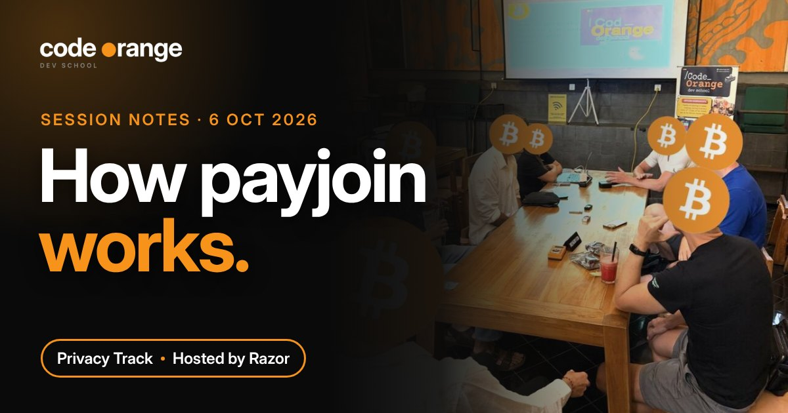
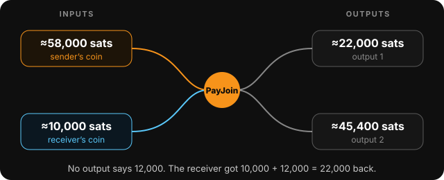
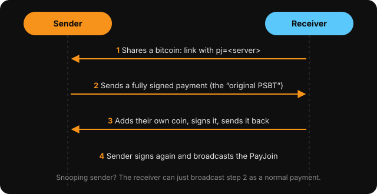

# Privacy Track: How PayJoin Works

**Date:** Tuesday 6 October 2026, 07:00 UTC
**Where:** Code Orange Dev School Discord
**Host:** Razor
**Series:** Privacy Track (every 1st and 3rd Tuesday; first session)
**Read on the website:** https://codeorange.dev/session-notes/2026-10-06-privacy-track

▶ **[Watch the full recording on YouTube](https://www.youtube.com/watch?v=lsgyE7OxpsM)**

> **TL;DR**
> - Privacy keeps Bitcoin free, censorship-resistant and fungible. Without private payments it can be captured like gold.
> - PayJoin mixes coins from the sender and the receiver in one transaction that looks completely normal.
> - That breaks two chain-analysis guesses: all inputs belong to one person, and the big leftover is the change.
> - PayJoin v2 needs no server of your own: a mailbox and a relay pass messages, and neither sees the whole picture.

## Highlights

- **Why a Privacy Track at all?** Sovereignty (nobody needs to see your balance or your coffee purchases), no censorship (no asking permission to pay), and fungibility (no "clean" vs "tainted" coins). And a trade-off: you can't get 100% privacy for 0% effort. Jeff Booth's idea was quoted: *if we don't have private payments, Bitcoin as an asset will fail.*
- **12,000 sats that don't show up on the blockchain.** A PayJoin of 12,000 sats from Bull Bitcoin to Cake Wallet was looked up on mempool.space live. No output said 12,000: the receiver added a ~10,000 sat coin and got ~22,000 back. Chain analysis sees two equally believable stories (paid ~36,000 or paid ~12,000) and can't tell which is true.

  

## Key takeaways

1. **PayJoin breaks two guesses.** Chain analysis assumes all inputs belong to one person and the big leftover is change. PayJoin adds a receiver coin, so both can be wrong. Unlike CoinJoin, it looks like a normal payment.
2. **The sender commits first.** A naive design lets a sender "ask" again and again to learn every coin the receiver owns (UTXO snooping). In the real protocol the sender first sends a fully signed payment, so if they misbehave the receiver just broadcasts it.

   

3. **v2 removes the receiver's server.** v1 needs the receiver to run a web server. v2 (async PayJoin) uses a mailbox directory plus an oblivious HTTP relay, run by different people who must not collude, and hides the sender's IP from the receiver.
4. **Not instant privacy.** One PayJoin won't fix coins already linked to you. Use it repeatedly, with other tools.
5. **Try it:** turn on PayJoin in Cake Wallet, copy the receive link (contains `pj=`), pay it from Bull Bitcoin. On the call only amounts over 10,000 sats went through, and not every attempt worked.

## Resources shared

**Reading**
- [Extreme Privacy](https://inteltechniques.com/book7.html), Michael Bazzell
- [Bitcoin Fog verdict](https://www.irs.gov/compliance/criminal-investigation/jury-finds-russian-swedish-operator-of-bitcoin-fog-guilty-of-running-the-darknet-cryptocurrency-mixer), IRS-CI (2024): this session's chain-analysis case
- [BIP 78: PayJoin v1](https://github.com/bitcoin/bips/blob/master/bip-0078.mediawiki) and [BIP 77: Async PayJoin v2](https://github.com/bitcoin/bips/blob/master/bip-0077.md)
- [BIP 21: payment URIs](https://github.com/bitcoin/bips/blob/master/bip-0021.mediawiki) (the `pj=` link) and [BIP 174: PSBT](https://github.com/bitcoin/bips/blob/master/bip-0174.mediawiki)

**Tools**
- [payjoin.org](https://payjoin.org): PayJoin Dev Kit and docs
- [mempool.space](https://mempool.space): used live to read the transaction
- [Blooket](https://play.blooket.com): the quiz platform used on the call

**Wallets**
- [Bull Bitcoin](https://www.bullbitcoin.com) and [Cake Wallet](https://cakewallet.com): send and receive PayJoin
- [Sparrow](https://sparrowwallet.com): send only (v1), so hardware wallets can pay through it
- [BTCPay Server](https://btcpayserver.org): receive on your own server (v1)

**Code Orange**
- [Privacy Developer Track](https://codeorange.dev/privacy-track): next is PayJoin part 2 on Tuesday 20 October
- [Code Review Club, 8 October](2026-10-08-code-review-club.md)
- Ideas from the call: a guide to choosing privacy tools per risk profile, a quiz leaderboard, and a capture-the-flag challenge in about six months

---
Notes by Code Orange Dev School. Join us on [Discord](https://codeorange.dev).
