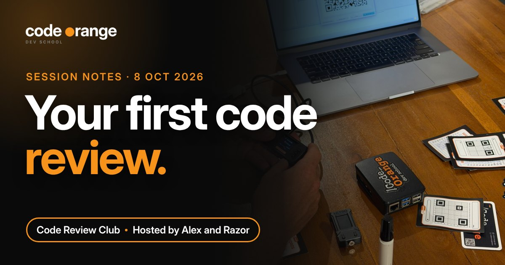

# Code Review Club: Your First Code Review

**Date:** Thursday 8 October 2026, 07:00 UTC
**Where:** Code Orange Dev School Discord
**Hosts:** Alex (Nostr) and Razor (Peer Observer)
**Series:** Code Review Club (first session; monthly)
**Read on the website:** https://codeorange.dev/session-notes/2026-10-08-code-review-club

▶ **[Watch the full recording on YouTube](https://www.youtube.com/watch?v=wQPdlsrxidY)** (1h 26m)

<b>Jump to a chapter</b>

- [00:00](https://www.youtube.com/watch?v=wQPdlsrxidY&t=0s) Welcome: the Code Orange pipeline
- [03:31](https://www.youtube.com/watch?v=wQPdlsrxidY&t=211s) Part 1: a Nostr identity with nihao
- [09:35](https://www.youtube.com/watch?v=wQPdlsrxidY&t=575s) Why Nostr? No sign-up, no permission
- [11:45](https://www.youtube.com/watch?v=wQPdlsrxidY&t=705s) Blossom and owning your own data
- [14:54](https://www.youtube.com/watch?v=wQPdlsrxidY&t=894s) Mastodon vs Nostr vs X
- [20:43](https://www.youtube.com/watch?v=wQPdlsrxidY&t=1243s) npub, nsec and relays
- [24:04](https://www.youtube.com/watch?v=wQPdlsrxidY&t=1444s) NIPs and event kinds
- [33:26](https://www.youtube.com/watch?v=wQPdlsrxidY&t=2006s) Ecash mints: get paid to your npub
- [39:20](https://www.youtube.com/watch?v=wQPdlsrxidY&t=2360s) Logging in safely, and nak
- [42:00](https://www.youtube.com/watch?v=wQPdlsrxidY&t=2520s) Should we run a Nostr workshop?
- [45:01](https://www.youtube.com/watch?v=wQPdlsrxidY&t=2701s) Part 2: Bitcoin's P2P network
- [48:47](https://www.youtube.com/watch?v=wQPdlsrxidY&t=2927s) Peer Observer and LinkingLion
- [51:16](https://www.youtube.com/watch?v=wQPdlsrxidY&t=3076s) Reviewing a PR: get context first
- [54:31](https://www.youtube.com/watch?v=wQPdlsrxidY&t=3271s) Checking out the PR branch
- [56:44](https://www.youtube.com/watch?v=wQPdlsrxidY&t=3404s) Asking Claude how to build it
- [1:01:17](https://www.youtube.com/watch?v=wQPdlsrxidY&t=3677s) Running the tests as root, and NATS
- [1:06:05](https://www.youtube.com/watch?v=wQPdlsrxidY&t=3965s) LLMs in open source: the debate
- [1:13:35](https://www.youtube.com/watch?v=wQPdlsrxidY&t=4415s) Break the test on purpose
- [1:17:23](https://www.youtube.com/watch?v=wQPdlsrxidY&t=4643s) Finding the entry point
- [1:21:24](https://www.youtube.com/watch?v=wQPdlsrxidY&t=4884s) Start by reviewing, not coding
- [1:23:17](https://www.youtube.com/watch?v=wQPdlsrxidY&t=4997s) Issue first, or PR first?

> **TL;DR**
> - Nostr is to X what Bitcoin is to a bank: you hold the key, nobody can ban your identity.
> - One command (nihao) gives you a Nostr identity, relays, a Lightning address and an ecash wallet.
> - Reviewing a PR starts with context, then build it, run the tests and try to break them.
> - Start contributing by reviewing, not coding. "I ran the tests and they pass" is a real review.

## Highlights

- **A Nostr identity in one command.** Alex installed Gigi's *nihao* and created a "Code Orange" account live. One command made the key pair, a profile, a relay list, a Lightning address and an ecash wallet. No company, no sign-up, no permission.
- **Reviewing a real Bitcoin PR, live.** Razor picked a pull request on Peer Observer, a tool that watches the Bitcoin P2P network for attacks, and reviewed it in front of everyone. He hit the walls a beginner hits (tests that need root, a missing NATS binary) and showed how to get past each one, partly by asking Claude.

**How Razor reviews a pull request:** get context (readme, PR, issue) → check out the branch and build it → run the tests → make them fail on purpose → find the entry point. Stuck? Paste the PR link into Claude and ask how to build and test it, then check what it says.

## Key takeaways

1. **Nostr is to X what Bitcoin is to a bank.** On X a company owns your account. On Mastodon your account lives on someone's server ("half decentralized", like most crypto). On Nostr you hold the key: relays can drop your posts, but nobody can take your identity, and you can move your followers and reputation to any app.
2. **Ecash makes money as easy as a message.** With Lightning you ask for money with an invoice. With ecash someone can drop sats on your npub like a note on your desk, which opens up paying for content in sats instead of selling attention to advertisers.
3. **Review before you code.** You don't need to be a maintainer to review. Running the tests and saying they pass on your machine is a valid review, and so is asking a question. For a small fix, just open the PR; for a bigger change, open an issue first.

   > "The more you learn about it, the more you realize how little you know." Razor, on Bitcoin

4. **LLMs: useful, but you still own the review.** The room was split. Razor's rule: a contributor should put in at least as much effort as the person reviewing their work.

## Resources shared

**Reading**
- [Nostr NIPs](https://github.com/nostr-protocol/nips): Nostr Implementation Possibilities, like BIPs for Nostr, with the list of event kinds
- [Blossom](https://github.com/hzrd149/blossom): storing media on servers you choose, tied to your Nostr key
- [Bitcoin P2P network reference](https://developer.bitcoin.org/reference/p2p_networking.html): how nodes talk to each other
- [LinkingLion: An entity linking Bitcoin transactions to IPs?](https://b10c.me/observations/06-linkinglion/), 0xB10C

**Tools**
- [nihao](https://github.com/dergigi/nihao) by Gigi: one command for a Nostr identity, relays, Lightning address and Cashu wallet, plus an npub health check
- [nak](https://github.com/fiatjaf/nak) by fiatjaf: command-line tool for Nostr events
- [Peer Observer](https://github.com/0xB10C/peer-observer) by 0xB10C: monitors the Bitcoin P2P network with honeypot nodes; the PR we reviewed adds integration tests to its eBPF extractor
- [NATS](https://nats.io): the message queue Peer Observer's tests need (set `NATS_SERVER_BINARY`)
- [Claude](https://claude.ai): the free plan is enough to paste a PR link and ask how to build and test it
- Ecash: [Cashu](https://cashu.space), [Minibits](https://www.minibits.cash), [Coinos](https://coinos.io)
- [Arkade](https://arkadeos.com): project an attendee contributes to, where LLMs do most first-pass reviews
- Nostr apps: [Jumble](https://jumble.social) (used in the demo), [Primal](https://primal.net), [Damus](https://damus.io), [Amethyst](https://github.com/vitorpamplona/amethyst); compared with [Mastodon](https://joinmastodon.org)

**Code Orange**
- [Privacy Developer Track](https://codeorange.dev/privacy-track): every 1st and 3rd Tuesday; next is PayJoin on 20 October
- [Decoding Bitcoin cohort](https://codeorange.dev/decoding-bitcoin): 10 weeks from Monday 16 November (announced on the call as Mastering Bitcoin)
- Ideas from the call: a monthly Nostr workshop, and one topic per Code Review Club instead of two

---
Notes by Code Orange Dev School. Join us on [Discord](https://codeorange.dev).
