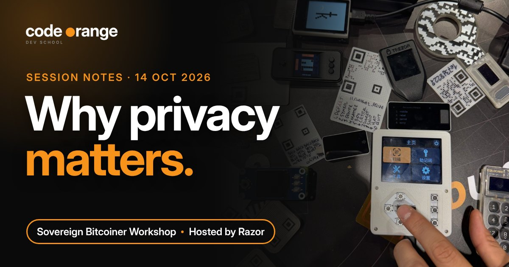
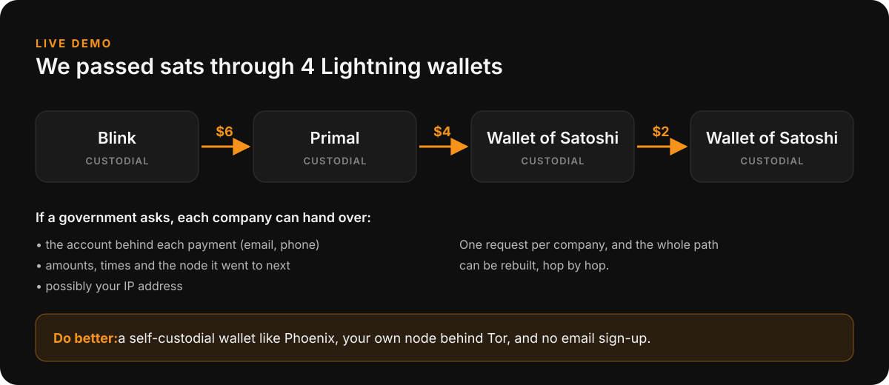
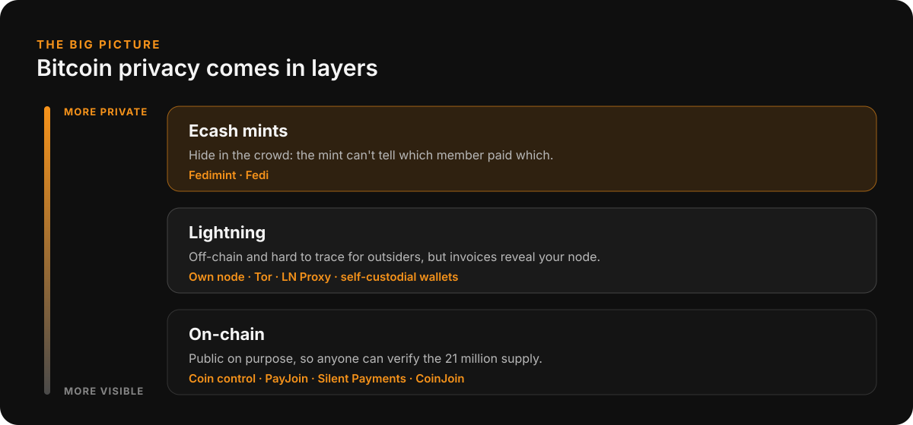

# Sovereign Bitcoiner Workshop: Why Privacy Matters

**Date:** Wednesday 14 October 2026, 11:00 UTC
**Where:** Code Orange Dev School Discord, Bitcoiner Lounge
**Host:** Razor
**Series:** Sovereign Bitcoiner Workshops (every 2nd Wednesday of the month)
**Read on the website:** https://codeorange.dev/session-notes/2026-10-14-sovereign-bitcoiner-workshop

▶ **[Watch the full recording on YouTube](https://www.youtube.com/watch?v=NENhVbqtGTs)** (1h 18m)

<b>Jump to a chapter</b>

- [00:00](https://www.youtube.com/watch?v=NENhVbqtGTs&t=0s) Why read "The Eternal Value of Privacy"
- [04:21](https://www.youtube.com/watch?v=NENhVbqtGTs&t=261s) The $100 carpet that leaked 1 BTC
- [06:51](https://www.youtube.com/watch?v=NENhVbqtGTs&t=411s) Is privacy a basic human right?
- [08:03](https://www.youtube.com/watch?v=NENhVbqtGTs&t=483s) 1984 vs Kafka's The Trial
- [12:04](https://www.youtube.com/watch?v=NENhVbqtGTs&t=724s) Did Satoshi make Bitcoin transparent on purpose?
- [18:33](https://www.youtube.com/watch?v=NENhVbqtGTs&t=1113s) Why the base layer must be auditable
- [20:59](https://www.youtube.com/watch?v=NENhVbqtGTs&t=1259s) The cypherpunk manifestos
- [24:04](https://www.youtube.com/watch?v=NENhVbqtGTs&t=1444s) What is privacy? Three definitions
- [28:32](https://www.youtube.com/watch?v=NENhVbqtGTs&t=1712s) Mass data collection and laws that change
- [31:48](https://www.youtube.com/watch?v=NENhVbqtGTs&t=1908s) Fun fact: 2016 blocks is 6102 backwards
- [33:58](https://www.youtube.com/watch?v=NENhVbqtGTs&t=2038s) Private payments on a public chain
- [37:15](https://www.youtube.com/watch?v=NENhVbqtGTs&t=2235s) Is Lightning more secure? Liveness and watchtowers
- [41:27](https://www.youtube.com/watch?v=NENhVbqtGTs&t=2487s) Invoices reveal your node: Tor, ecash, guard nodes
- [46:18](https://www.youtube.com/watch?v=NENhVbqtGTs&t=2778s) Live demo: tracing a Lightning payment
- [48:43](https://www.youtube.com/watch?v=NENhVbqtGTs&t=2923s) LN Proxy and 1ML
- [52:05](https://www.youtube.com/watch?v=NENhVbqtGTs&t=3125s) Hardware wallet or dedicated laptop?
- [57:56](https://www.youtube.com/watch?v=NENhVbqtGTs&t=3476s) The Intel Management Engine
- [1:01:49](https://www.youtube.com/watch?v=NENhVbqtGTs&t=3709s) Who are we protecting our bitcoin from?
- [1:10:13](https://www.youtube.com/watch?v=NENhVbqtGTs&t=4213s) How much trouble are you willing to go through?
- [1:14:16](https://www.youtube.com/watch?v=NENhVbqtGTs&t=4456s) Private messengers: White Noise and Keychat

> **TL;DR**
> - "Nothing to hide" is the wrong question. Privacy is about power.
> - Bitcoin is public on purpose. Privacy is added in layers on top.
> - Custodial wallets can hand your payment history to anyone who asks.
> - Pick your defences with a simple threat model, not fear.

## Highlights

- **A $100 carpet that leaked 1 BTC.** A community member bought a carpet for bitcoin on Facebook Marketplace and looked the on-chain payment up on a block explorer. It showed the seller's wallet held a full bitcoin. Now a stranger knew what the seller looked like, where they lived and how much they had. That is what a privacy leak looks like in real life.
- **Live Lightning privacy test.** We passed $6 of sats from Blink to Primal to Wallet of Satoshi and on to another Wallet of Satoshi user, then traced what each company could hand over if a government came knocking: node IDs, emails, maybe IP addresses. Custodial Lightning is fairly private from other people, but not from the custodians themselves.

## Key takeaways

1. **"Nothing to hide" is the wrong question.** Privacy is about the balance of power between you and whoever holds your data. Data outlives the laws that protect it (Executive Order 6102 made owning gold illegal in the US overnight).

   > "Arguing that you don't care about the right to privacy because you have nothing to hide is no different than saying you don't care about free speech because you have nothing to say." Edward Snowden, quoted on the call

2. **Bitcoin's base layer is transparent on purpose.** Anyone can verify the 21 million supply. Privacy is added on top: good on-chain habits (coin control, PayJoin, Silent Payments), Lightning, and ecash mints like Fedimint.

   

3. **Be productively paranoid, but practical.** Answer four questions: **Who** am I protecting against? **How likely** is it? **How bad** is failure? **How much effort** will I spend? Self-custody wallets, your own node behind Tor and ecash all raise the bar.

## Resources shared

**Reading**
- [The Eternal Value of Privacy](https://www.schneier.com/essays/archives/2006/05/the_eternal_value_of.html), Bruce Schneier (2006)
- ['I've Got Nothing to Hide' and Other Misunderstandings of Privacy](https://papers.ssrn.com/abstract=998565), Daniel J. Solove (2007)
- [Why Privacy Matters](https://www.privacyguides.org/en/basics/why-privacy-matters/), Privacy Guides
- [A Cypherpunk's Manifesto](https://www.activism.net/cypherpunk/manifesto.html), Eric Hughes (1993)
- [The Crypto Anarchist Manifesto](https://www.activism.net/cypherpunk/crypto-anarchy.html), Timothy C. May (1988)
- [Bitcoin: A Peer-to-Peer Electronic Cash System](https://bitcoin.org/bitcoin.pdf), Satoshi Nakamoto (2008)
- *1984* by George Orwell and *The Trial* by Franz Kafka, used as the two metaphors for surveillance (self-censorship) and data collection (power imbalance)
- [Executive Order 6102](https://en.wikipedia.org/wiki/Executive_Order_6102) (1933). Fun fact from the call: Bitcoin's difficulty adjusts every 2016 blocks, which is 6102 backwards.
- [Intel Management Engine](https://en.wikipedia.org/wiki/Intel_Management_Engine), on why a general-purpose laptop is a hard place to keep keys

**Tools**
- [mempool.space](https://mempool.space): block explorer used in the carpet story
- [1ML](https://1ml.com): Lightning node explorer
- [LN Proxy](https://lnproxy.org): wraps a Lightning invoice so payers don't see your node (used by [RoboSats](https://learn.robosats.org))
- [Fedimint](https://fedimint.org) and [Fedi](https://www.fedi.xyz): federated ecash mints
- [White Noise](https://www.whitenoise.chat) and [Keychat](https://www.keychat.io): private messengers built on Nostr, Keychat with ecash and Lightning built in
- Wallets mentioned: [Phoenix](https://phoenix.acinq.co), [Blink](https://www.blink.sv), [Primal](https://primal.net), [Wallet of Satoshi](https://www.walletofsatoshi.com), [BlueWallet](https://bluewallet.io) (can freeze UTXOs), [Sparrow](https://sparrowwallet.com)

**Code Orange**
- [Privacy Developer Track](https://codeorange.dev/privacy-track): every 1st and 3rd Tuesday, covering PayJoin, Silent Payments, Lightning and ecash
- Next session: Self-Custody and Multisig workshop with Andy, Friday 16 October ([calendar](https://codeorange.dev/calendar))
- Ideas for future sessions: a White Noise vs Keychat comparison, and a Fedimint deep dive

---
Notes by Code Orange Dev School. Join us on [Discord](https://codeorange.dev).
