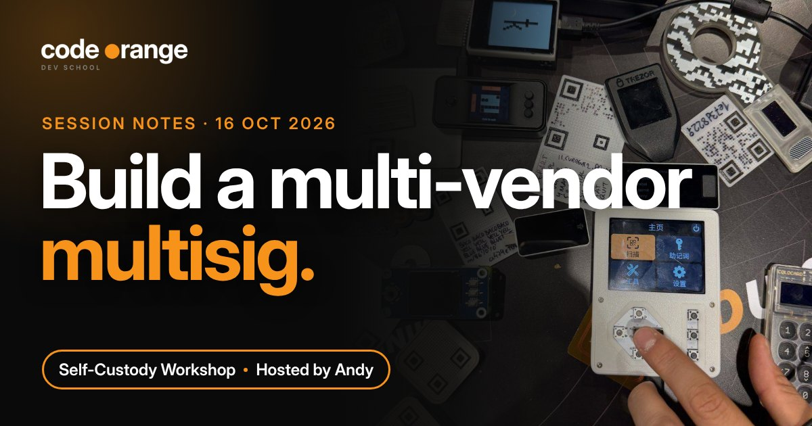

# Self-Custody Workshop: Build a Multi-vendor Multisig

**Date:** Friday 16 October 2026, 07:00 UTC
**Where:** Code Orange Dev School Discord
**Host:** Andy
**Series:** Self-Custody Workshops (every 3rd Friday of the month)
**Read on the website:** https://codeorange.dev/session-notes/2026-10-16-self-custody-workshop



> **TL;DR**
> - Multisig from different vendors means one bad device can't take your coins.
> - 2-of-3: any two keys can spend, so you can lose one and still be fine.
> - Back up the wallet file (output descriptor) everywhere. Without it you can't rebuild the wallet.
> - New to self-custody? Start with one hardware wallet, then a passphrase, then multisig.

## Highlights

- **Can you sleep well at night?** If your whole stack sits on one Ledger, Trezor or Coldcard and you read about a supply chain attack on that brand, what then? The call brought up recent news of a Ledger supply chain attack through resellers and a Coldcard exploit. Spreading your keys across vendors means one bad device can't take your coins.
- **A live 2-of-3 in Sparrow, restored in Nunchuk.** Andy built the wallet with a Trezor and a Ledger over USB and an air-gapped Coldcard Q over microSD, spent from it with two keys, then rebuilt the same wallet in Nunchuk and spent again.

```
Trezor (USB) + Ledger (USB) + Coldcard Q (microSD)  ->  2-of-3 wallet in Sparrow
```

1. **New wallet** -> policy type *Multi Signature*, slider set to 2 of 3.
2. **Keys 1 and 2:** plug in, enter the PIN, *Connected Hardware Wallet* -> Scan -> Import Keystore.
3. **Key 3 (air-gapped):** on the Coldcard, Advanced Tools -> Export Wallet -> Sparrow, then load the JSON file from the microSD card.
4. **Check** each key's derivation path reads `m/48'/0'/0'/2'` (native SegWit multisig, BIP 48).
5. **Spend:** Trezor signs over USB, the PSBT goes to the Coldcard on the microSD card and comes back signed, then broadcast.
6. **Restore elsewhere:** Sparrow Settings -> Export, then in Nunchuk *Recover existing wallet* -> *via BSMS/descriptor*. Importing the raw descriptor needed manual edits, so the exported file was easier.

## Key takeaways

1. **The wallet file matters as much as the keys.** The output descriptor is the blueprint of a multisig. Without it, rebuilding the wallet is very hard. Anyone who finds it can see your balance and history, but can't spend, so keep copies in many places and keep each seed in a different place.

   > "On average, the biggest risk to your bitcoin is not the hacker. It's you." One of the hosts, who once lost $13 in a test multisig by forgetting which keys he had used

2. **Climb one step at a time:** a mobile wallet with $10 to practise, then one hardware wallet, then a passphrase (a secret extra word on top of your seed), then multisig.
3. **2-of-4 is possible too.** An extra key protects against a dead device, but means one more place to keep safe. Buy hardware wallets straight from the maker, never a reseller.

## Resources shared

**Wallets**
- [Sparrow Wallet](https://sparrowwallet.com) ([docs](https://sparrowwallet.com/docs/)): desktop wallet used to build the multisig. There is no Sparrow mobile app, so a "Sparrow" app on your phone is a scam.
- [Nunchuk](https://nunchuk.io): multisig wallet with desktop and mobile apps, used to restore the wallet
- [BlueWallet](https://bluewallet.io): mobile wallet to practise sending and receiving first
- [Cake Wallet](https://cakewallet.com): mobile wallet with PayJoin and Silent Payments, used to receive on the call

**Hardware wallets**
- Used in the demo: [Trezor](https://trezor.io), [Ledger](https://www.ledger.com), [Coldcard Q](https://coldcard.com)
- Recommended for beginners: [Blockstream Jade](https://blockstream.com/jade/), [BitBox02](https://bitbox.swiss), [OneKey](https://onekey.so)

**Reading**
- [BIP 48: Multi-script hierarchy for multisig wallets](https://github.com/bitcoin/bips/blob/master/bip-0048.mediawiki): where the `m/48'/0'/0'/2'` path comes from

**Code Orange**
- [Privacy Developer Track](https://codeorange.dev/privacy-track): every 1st and 3rd Tuesday, next one Tuesday 20 October ([calendar](https://codeorange.dev/calendar))
- Ideas for future sessions: a Nunchuk deep dive (miniscript, group wallets, inheritance), planned for December, and a passphrase wallet demo

---
Notes by Code Orange Dev School. Join us on [Discord](https://codeorange.dev).
