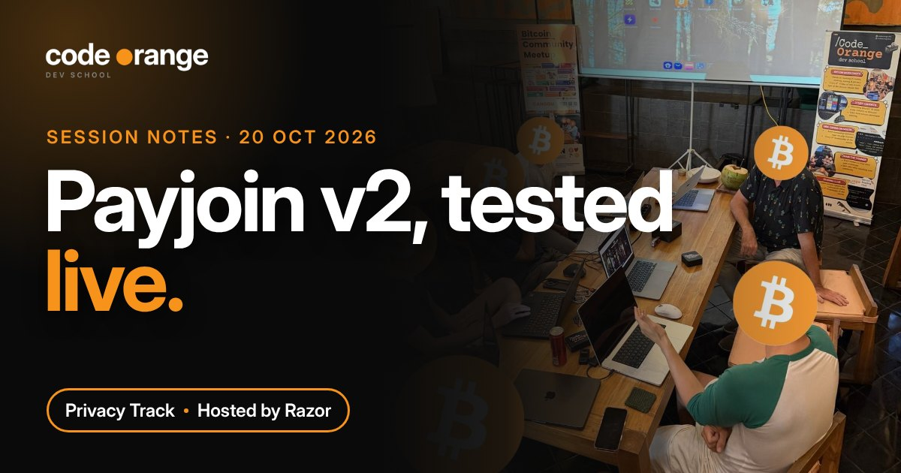
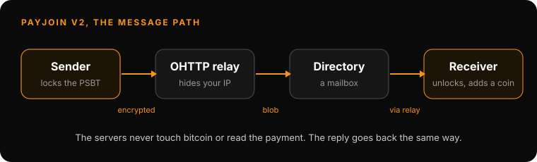

# Privacy Track: PayJoin v2, tested live

**Date:** Tuesday 20 October 2026, 07:00 UTC
**Where:** Code Orange Dev School Discord
**Host:** Razor
**Read on the website:** https://codeorange.dev/session-notes/2026-10-20-privacy-track

**Recording:** https://youtu.be/g5TAfT07ghE

> **TL;DR**
> - PayJoin v2 needs no server of your own: a mailbox directory holds encrypted messages and a relay hides your IP address.
> - Neither server ever touches your bitcoin or can read the payment. Run by two different parties, neither can link sender and receiver.
> - Live tests mostly failed: silent fallbacks to normal payments, v1/v2 mismatches, and no clear error messages.
> - The protocol is simple. The wallet experience is the work left to do, and that is where new contributors come in.

## Highlights

- **How v2 works.** In a PayJoin the receiver adds one of their own coins, so sender and receiver must swap a partly signed transaction (PSBT) first. In v1 the receiver ran an always-online server. In v2 the sender encrypts the PSBT with the receiver's public key and drops it in a mailbox (the directory) through an OHTTP relay that hides their IP, a bit like Tor. The receiver can be offline and pick it up later. The PayJoin link itself carries the directory, the mailbox ID and the receiver's public key. If one party ran both the relay and the directory, it could link the IP addresses again, so they should be run by different people.

  

- **Testing it live.** One incoming PayJoin from an earlier session showed up on mempool.space as 2 inputs and 2 outputs, as it should. New attempts on the call hit different walls: Cake Wallet quietly sent a normal payment when the PayJoin failed; pasting the link failed but scanning the QR code worked; Bull Bitcoin showed a "v1" error (sender and receiver need the same version); the receiver needs confirmed coins of their own; and Bull Bitcoin asked for a minimum of about 10,000 sats, which isn't in the spec. The ask from the room: "Show me the error. Show me what I can do. Tell me if it worked."

## Key takeaways

1. **Use it every time.** PayJoin looks like a normal payment, unlike a CoinJoin, which is easy to spot. The idea shared on the call: if even 5 to 10% of payments were PayJoins, chain analysis could no longer trust its "all inputs belong to one person" guess.
2. **Know the trade-off.** The person who receives your PayJoin learns a little about your coins, and you about theirs.
3. **Start contributing by running it.** Build rust-payjoin, make a PayJoin, break a test, then review an open pull request. Bindings for other languages and the new BTCPay Server plugin need help. Razor is building hands-on labs: make a PayJoin, talk to the relay, talk to the directory, find and fix a bug.

Quiz recap

- Inputs in a PayJoin? At least two. More is allowed in theory, but wallets use two today.
- Is v2 more private than v1? Yes, thanks to the relay and the directory.
- Who can host the relay? Anyone.
- What does the directory see? Only the receiver's public key.
- Who needs to read the UTXO set? Only the receiver.
- PayJoin or CoinJoin, which is safer? It depends on what you are protecting against.

## Resources shared

**Reading**
- [BIP 77: Async PayJoin (v2)](https://github.com/bitcoin/bips/blob/master/bip-0077.md): the mailbox directory and relay design
- [BIP 78: PayJoin (v1)](https://github.com/bitcoin/bips/blob/master/bip-0078.mediawiki): the older version with a receiver server
- [RFC 9458: Oblivious HTTP](https://www.rfc-editor.org/rfc/rfc9458): the standard behind the OHTTP relay
- [RFC 9180: HPKE](https://www.rfc-editor.org/rfc/rfc9180): the encryption that locks the PSBT

**Tools**
- [rust-payjoin](https://github.com/payjoin/rust-payjoin): the core PayJoin library, now including the OHTTP relay
- [PayJoin on GitHub](https://github.com/payjoin): all PayJoin projects, including the BTCPay Server plugin (alpha)
- [payjoin.org](https://payjoin.org): docs and supported wallets
- [Cake Wallet issues](https://github.com/cake-tech/cake_wallet/issues): check here before reporting a PayJoin bug
- [mempool.space](https://mempool.space): check whether a payment really was a PayJoin
- [Blooket](https://play.blooket.com): the quiz used on the call

**Wallets**
- [Cake Wallet](https://cakewallet.com): PayJoin v2, falls back to a normal payment if it fails
- [Bull Bitcoin](https://www.bullbitcoin.com): PayJoin v2
- [Sparrow](https://sparrowwallet.com): sends PayJoin v1 only
- [BTCPay Server](https://btcpayserver.org): receives PayJoin v1; v2 plugin in alpha

**Code Orange**
- [PayJoin part 1, 6 October](2026-10-06-privacy-track.md)
- [Privacy Developer Track](https://codeorange.dev/privacy-track): every 1st and 3rd Tuesday, 07:00 UTC · 15:00 UTC+8. Next: Tuesday 3 November.

---
Notes by Code Orange Dev School. Join us on [Discord](https://codeorange.dev).
