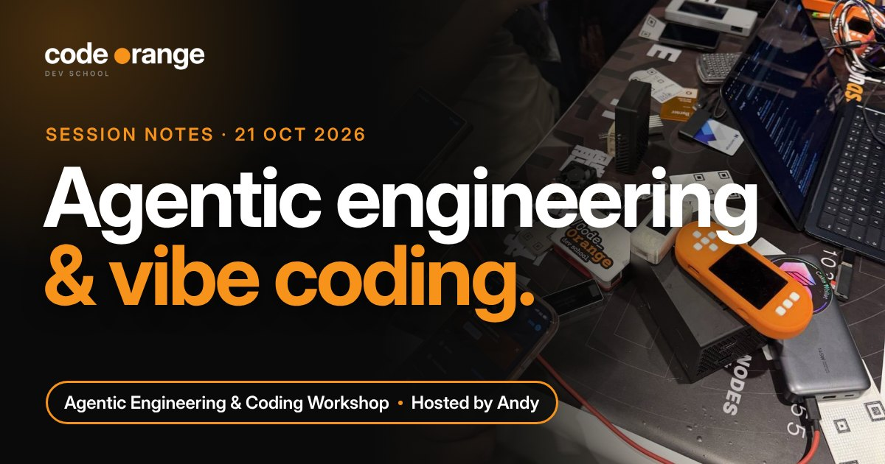
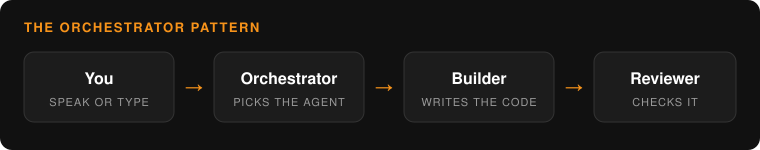

# Agentic Engineering & Coding Workshop: agentic engineering and vibe coding

**Date:** Wednesday 21 October 2026, 12:00 UTC
**Where:** Code Orange Dev School Discord
**Host:** Andy
**Read on the website:** https://codeorange.dev/session-notes/2026-10-21-agentic-engineering

**Recording:** coming soon on YouTube.

> **TL;DR**
> - You don't need to code to build: describe what you want, speak instead of typing, and let the agent do the work.
> - Andy's self-custody simulator lets newcomers practise a hardware wallet, a seed backup and a recovery before using real bitcoin.
> - A one-shot HTML page plus the mempool.space API became a set of live transaction visualizers with lightning tips that rain on every viewer's screen.
> - The next step is orchestration: one agent you talk to that hands work to builder and reviewer agents in Claude, Codex and Hermes.

## Highlights

- **A self-custody simulator, built by talking to an agent.** Some people own a hardware wallet but are too scared to move their bitcoin onto it. Andy built an interactive simulator in Bolt so they can practise first, guided by a mentor character, with no real money at stake. Missions run in order: set up a hardware wallet, withdraw from an exchange, recover (reset and re-enter the 12 words), connect wallet software. Feedback from the call: make it impossible to miss that seed words go into the hardware wallet only, never into a website or software wallet, and add translations (Chinese was asked for first).

- **The mempool as a fish tank, a beehive and a T-shirt factory.** A builder asked several AI models for a live Bitcoin transaction visualizer. One answer was a single HTML file using the mempool.space API that just worked. With a cheap model in OpenCode he grew it into Sea (fish and whales by size), Bee (a beehive that switches to night for the viewer), Tee (a T-shirt conveyor belt) and Matrix and Tetris views. Send a lightning tip with a message and bolts rain on everyone who has the page open.

- **From finding issues to running a team of agents.** One builder scans about 50 Bitcoin repositories, matches open issues and good first issues to your GitHub skills and sends daily updates to Telegram. Another is building a Mac and iPhone app around an orchestrator: you speak to one agent and it hands the work to builder and reviewer agents, even in different harnesses (Claude, Codex, Hermes).

  

> "Now we need to unlearn the things we think we cannot do. Come up with an idea, speak to the laptop, and it becomes real."

## Key takeaways

1. **Speak, don't type.** Two minutes of talking into the microphone gives the agent more context than a short typed prompt, and it's faster. Superwhisper and Omarchy's dictation were recommended.
2. **Small and cheap goes a long way.** A single HTML file and a free API made a fun Bitcoin tool. Cheap models did most of the work, with a stronger model only when the agent got stuck.
3. **Payments are easy to hand to an agent.** Alby Hub was the quickest to wire up; BTCPay Server on an Umbrel runs the tip button on the workshop page. TollGate (routers that sell Wi-Fi or AI access for ecash) is a planned session.

Chapters (times from the transcript, may be slightly off)

- 0:00 Warm-up: Omarchy on an Umbrel Home
- 2:03 Selling Wi-Fi and AI for ecash with TollGate
- 5:30 Intros: how everyone uses AI
- 13:00 A business website rebuilt in two days
- 16:15 BTCPay tips on the page, BTCPay vs Alby Hub
- 20:10 Andy: a self-custody simulator built with Bolt
- 23:30 Bolt's agent modes, history and plan mode
- 30:00 Simulator missions: recover a wallet, pair software
- 41:10 Feedback: seed warnings and translations
- 44:00 Mempool visualizers: Sea, Bee and Tee
- 52:00 Lightning tips that rain on every screen
- 55:00 Matrix and Tetris views of the mempool
- 60:00 An issue finder for Bitcoin open source
- 68:10 An orchestrator agent across harnesses
- 72:50 Darkbloom, Buzz and Herdr
- 84:00 Voice tools, window managers and wrap-up

## Resources shared

**Tools**
- [Bolt](https://bolt.new): the vibe coding app Andy used for the simulator: chat with the agent, click an element to change it, roll back from history, publish in one click
- [OpenCode](https://opencode.ai): open-source coding agent for the terminal, paired with a cheap DeepSeek model to build the visualizers
- [Hermes Agent](https://github.com/NousResearch/hermes-agent), Nous Research: open-source agent used as a personal workspace and one of the harnesses an orchestrator can hand work to
- [DeepSeek](https://www.deepseek.com): low-cost models (V4 Flash) that were "cheap, reliable and enough" for small web projects
- [Buzz](https://github.com/block/buzz), Block: lets agents in different harnesses talk to each other; ideas from it went into the orchestrator app
- [Herdr](https://betterstack.com/community/guides/ai/herdr-ai-agent/): a tmux-style terminal for agents: an orchestrator hands tasks to a builder pane and a reviewer pane (guide)
- [Darkbloom](https://docs.darkbloom.dev/introduction): rent out a Mac's spare compute to run open models for OpenRouter users and get paid
- [OpenRouter](https://openrouter.ai): one API for many AI models, where Darkbloom machines show up as a provider
- [Superwhisper](https://superwhisper.com): voice-to-text on your computer, recommended for talking to agents instead of typing
- [Suno](https://suno.com): AI music, used for the soundtrack of the mempool visualizers
- [Vercel](https://vercel.com): commit to GitHub and the site deploys itself, so a refresh shows the agent's change
- [mempool.space API](https://mempool.space/docs/api): the free data source behind the live transaction visualizers
- [BitListen](https://www.bitlisten.com): listen to Bitcoin transactions as bubbles and sounds; one of the inspirations for the visualizers
- [Omarchy](https://omarchy.org): a keyboard-driven Linux setup several builders are trying; it comes with Herdr and voice dictation
- [Umbrel](https://umbrel.com): home server that runs BTCPay Server and more; it travels with the host
- [Start9](https://start9.com): home server; one builder turned an old one into the always-on box for nightly agent jobs
- [Cloudflare Tunnel](https://developers.cloudflare.com/cloudflare-one/connections/connect-networks/): reach a home server from your phone without opening ports
- [Jellyfin](https://jellyfin.org): open-source media server; the orchestrator can read its subtitles and "watch" with you
- [Alby Hub](https://albyhub.com): self-custodial lightning node; the quickest one to hand to an agent for payments
- [BTCPay Server](https://btcpayserver.org): used for the tip button on the workshop page (lightning and on-chain); a bit more setup than Alby Hub
- [AeroSpace](https://github.com/nikitabobko/AeroSpace): open-source tiling window manager for macOS
- [Komorebi](https://github.com/LGUG2Z/komorebi): tiling window manager for Windows
- [Raycast](https://www.raycast.com): keyboard launcher for macOS

**Code Orange**
- [PayJoin v2, tested live, 20 October](2026-10-20-privacy-track.md)
- [Agentic Engineering workshop](https://codeorange.dev/programs/agentic-engineering): every 3rd Wednesday, 12:00 UTC on Discord
- [Bitcoin Reading Club](https://codeorange.dev/programs/bitcoin-reading-club): next session Wednesday 28 October, 12:00 UTC

Ideas for future sessions: a TollGate session (routers that sell Wi-Fi, and even AI access, for ecash and lightning), a hands-on Omarchy workshop, and a screen-shared demo of the orchestrator app and Herdr. Feedback for the simulator: warn clearly never to type seed words into a website or software wallet, and add translations (Chinese was asked for first).

---
Notes by Code Orange Dev School. Join us on [Discord](https://codeorange.dev).
