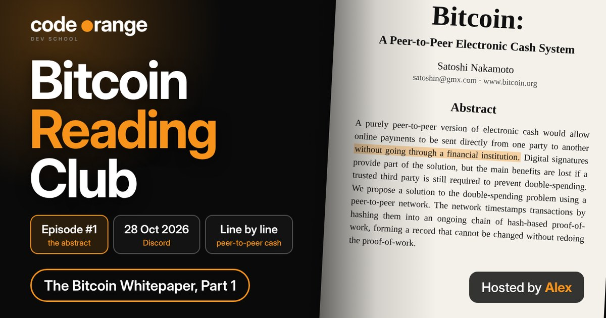

# Bitcoin Reading Club: The Whitepaper Abstract, Line by Line

**Date:** Wednesday 28 October 2026, 12:00 UTC
**Where:** Code Orange Dev School Discord
**Host:** Alex
**Series:** Bitcoin Reading Club (every 4th Wednesday of the month)
**Read on the website:** https://codeorange.dev/session-notes/2026-10-28-bitcoin-reading-club



> **TL;DR**
> - The key line: peer-to-peer cash, without going through a financial institution.
> - Signatures prove you own coins, but they can't stop you paying the same coins twice. The network does that.
> - Proof of work plus the longest chain decide which history is true, so rewriting it would take most of the world's hash power.
> - Spend some bitcoin and buy it back. A coin that never moves ends up like gold in a vault.

<details>
<summary>Chapters (times taken from the transcript, may be slightly off)</summary>

- 00:00 Intro: reading the whitepaper together
- 01:47 The first line: peer-to-peer, no financial institution
- 04:14 What did Satoshi mean by "electronic cash"?
- 07:11 Bitcoin as the ultimate bearer asset
- 13:27 Digital signatures and the double spending problem
- 16:03 Peer-to-peer network: node runners are the police
- 17:08 Timestamps, hashing and the chain of proof of work
- 19:12 The airplane analogy: how all the parts fit together
- 22:00 Should you spend your Bitcoin? Spend and replace
- 30:00 The longest chain and the 51% attack
- 36:10 CPUs, GPUs and ASICs: how mining changed
- 42:57 Why run your own node?
- 45:27 "Minimal structure" and best-effort broadcasting
- 52:34 Discussion: the paper's core proposal
- 56:35 Proof of work, energy and game theory
- 60:53 Why signatures are only part of the solution
- 68:27 Why the largest pool of CPU power matters
- 71:11 Nodes leave and rejoin at will
- 73:34 Why a timestamped chain and not a plain list?
- 76:16 Wrap-up and what's next

</details>

## Test yourself

Play the interactive version (6 levels, XP and a rank) on the website: https://codeorange.dev/session-notes/2026-10-28-bitcoin-reading-club

1. Why is "without going through a financial institution" the key line?
2. "Cash" here is the opposite of what?
3. Signatures prove a coin is yours. What problem is left?
4. Why not just keep a plain public list of transactions?
5. What would it take to rewrite Bitcoin's history?
6. Why does it matter that nodes can leave and rejoin at will?

<details>
<summary>Answers</summary>

1. No middleman means nobody to shut it down.
2. Credit: once paid, cash can't be reversed (a bearer asset).
3. Double spending: you could sign the same coin over to many people.
4. Anyone could quietly edit a list. Changing the chain means redoing the proof of work.
5. More than half of all the hash power (a 51% attack).
6. No central point to attack. Every node checks every rule.

</details>

## Highlights

- **One sentence that started it all.** Alex went through the abstract one sentence at a time. The first line got the most time: *"A purely peer-to-peer version of electronic cash would allow online payments to be sent directly from one party to another without going through a financial institution."* It is why Bitcoin is so hard to ban: as long as two people want to trade, there is no middleman to shut down.
- **Should you spend your bitcoin?** The answer from the room: spend and replace. Pay for small things in bitcoin, then buy the same amount back. Merchants only accept bitcoin if people pay with it, and coins that never move end up like gold in a vault.

```
Peer-to-peer cash -> Signatures (prove you own it) -> Double spend? (still unsolved)
  -> Proof of work chain (timestamps history) -> Longest chain (is the truth)
```

> The airplane: Bitcoin is the plane, proof of work is the engine, the blockchain is the wings, the peer-to-peer network and cryptography are the cabin. A blockchain on its own is just a metal dining table.

## Key takeaways

1. **"Cash" means final, not small.** Cash is the opposite of credit: once paid, it can't be reversed and nobody else's promise stands behind it. That makes bitcoin a bearer asset. Lightning and ecash now handle the small, fast payments on top.
2. **Node runners are the police.** Every node checks every rule. Run your own to verify the bitcoin you receive and choose the rules you support. Nodes can leave and rejoin at will and catch up on the longest chain. No central server, no choke point.
3. **Energy is the security.** Miners chase rewards with better machines (CPU, then GPU, then ASIC). That makes rewriting history so expensive that a big company couldn't just break Bitcoin for fun.

## Resources shared

**Reading**
- [Bitcoin: A Peer-to-Peer Electronic Cash System](https://bitcoin.org/bitcoin.pdf) (Satoshi Nakamoto, 2008): the whitepaper. We covered the abstract; chapters 1 and 2 are next.
- [Bearer instrument](https://en.wikipedia.org/wiki/Bearer_instrument): an asset where control proves ownership. Looked up on the call.
- [Byzantine fault (the Byzantine Generals Problem)](https://en.wikipedia.org/wiki/Byzantine_fault): the coordination problem proof of work solves without a central party.

**Tools**
- [Bitcoin Core](https://bitcoincore.org): run your own node.

**Code Orange**
- [Decoding Bitcoin cohort](https://codeorange.dev/decoding-bitcoin): 10 weeks on how Bitcoin works under the hood. Starts Monday 16 November.
- [Bitcoin Basics](https://codeorange.dev/programs/bitcoin-basics): beginner meetup, next one Thursday 5 November.

**Next session:** Bitcoin Basics, Thursday 5 November on Discord. The Reading Club is back on the 4th Wednesday of November, 12:00 UTC, with a sats quiz.
