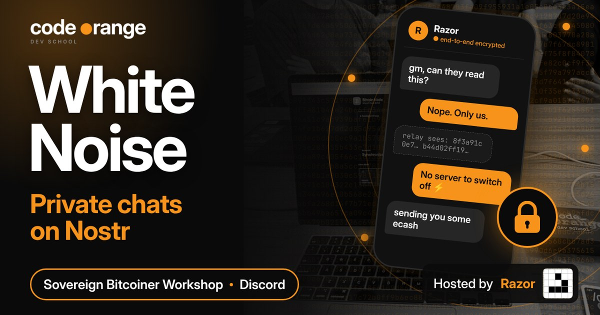
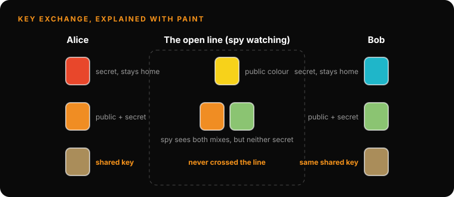
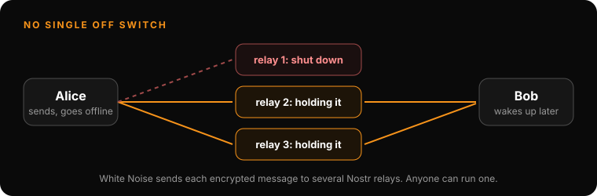

# Sovereign Bitcoiner Workshop: White Noise, Private Chats on Nostr

**Date:** Wednesday 11 November 2026
**Where:** Code Orange Dev School Discord
**Host:** Razor (with a live demo by Alex)
**Series:** Sovereign Bitcoiner Workshop
**Read on the website (with 5 mini-games):** https://codeorange.dev/session-notes/2026-11-11-sovereign-bitcoiner-workshop

▶ **[Watch the full recording on YouTube](https://www.youtube.com/watch?v=X-ZQRp74hH4)** (about 90 min)

> **TL;DR**
> - Every chat app needs something in the middle to hold your messages while you are offline. The question is who runs it and what it can read.
> - Encrypting is the easy part. The hard part is two people agreeing on a key over a line anyone can watch, and knowing the key really belongs to your friend.
> - White Noise keeps the encryption (MLS) and swaps the company server for Nostr relays that anyone can run, so there is no single off switch.
> - Old-style Nostr DMs hide the text but show who messaged whom and when. Gift wrap is the fix, and it is still being finished.

## Play it

The website version is a small game: mix a shared key in the paint lab, catch a man in the middle, try to censor a message, look at a DM the way a relay does, then beat the boss quiz. Five badges to collect: https://codeorange.dev/session-notes/2026-11-11-sovereign-bitcoiner-workshop

## Highlights

- **Why there is always a server in the middle.** Two phones can't just talk to each other, because one of them is often offline. Something has to hold the message. If that server encrypts for you, it still sees your plain text. With end-to-end encryption it only carries scrambled text. Telegram does not do this by default. Signal and WhatsApp do.

- **The hard part is the key exchange.** "Encrypting is very easy. The hard part is the key exchange." Razor explained Diffie-Hellman with paint: both sides mix a secret colour into a public one, swap the mixes in the open, then add their own secret again. Both end with the same colour, and it never crossed the line. Real maths, unlike paint, can't be un-mixed.

  

- **A good question from the room.** Why not just encrypt with your friend's public key? You can, but it is slow and easy to get wrong for photos and long chats. So apps use the slow maths once to agree on a shared key, then fast encryption (AES or ChaCha) for everything after.

- **Trust on first use.** The first time you message someone you simply trust the key you were given (TOFU). A man in the middle can swap keys so that both of you are really talking to them. Signal and WhatsApp let you compare a safety number or QR code in person to catch this. On Nostr the same question is: is this npub really my friend's?

- **Take the company away.** Signal, WhatsApp and Telegram each depend on one company's servers, which can be blocked or pressured. White Noise keeps the encryption and sends messages through Nostr relays instead.

  

  | Layer | What it does |
  |---|---|
  | White Noise | The app: chats and groups |
  | Marmot | The glue: how keys and group messages live on Nostr |
  | MLS (RFC 9420) | Key exchange and encryption, built for groups |
  | Nostr relays + Blossom | Relays hold small encrypted messages, Blossom holds photos and files |

- **The experiment: our own relay.** Razor ran his own relay (strfry, with a small plugin that logs every event) and set White Noise on phone and desktop to use only that relay. The relay received the "these are my relays" announcements (kinds 10002 and 10050) and gift wraps (kind 1059), but the test chat never arrived. His best guess, not confirmed: the relay list is fixed when a chat or group is created, so a change only affects new chats.

- **What a relay can see.** Alex logged into Primal with only someone's public key, read-only. He could see who had sent that person old-style Nostr DMs and when, but not the text. Gift wrap (NIP-59) seals the message in an envelope signed by a throwaway key with a shuffled date, so the sender and real time are hidden. Private messaging on Nostr is still work in progress.

- **Money in the chat.** An ecash token is just text, so any chat can carry it. BitChat works over Bluetooth with no internet and shows an ecash token as a tidy card. White Noise has no wallet built in today, and nobody on the call knew the roadmap.

  | App | End-to-end by default | What sits in the middle | One off switch? |
  |---|---|---|---|
  | Telegram | No, only "secret chats" | Telegram's servers | Yes |
  | WhatsApp | Yes (Signal protocol) | Meta's servers | Yes |
  | Signal | Yes | Signal's servers | Yes |
  | White Noise | Yes (MLS) | Nostr relays, pick your own | No |
  | BitChat | Yes (Noise) | Nothing: Bluetooth, phone to phone | No |

> "I just want to send the messages, send the ecash, and sleep well at night knowing my messaging app cannot be switched off."

## Key takeaways

1. **Encryption is solved. Trust and control are not.** What differs between apps is who holds the door: one company, or a network anyone can join.
2. **Check the key, not just the name.** A chat can be perfectly encrypted to the wrong person. Compare safety numbers, and double-check an npub through a second channel.
3. **Metadata talks.** Hiding the text is not enough if the world can see who you message and when.
4. **These tools need users, not only builders.** Trying them, breaking them and reporting what you find is a real contribution.

## Test yourself

1. Why does almost every chat app need something in the middle?
2. What did Razor call the hard part of end-to-end encryption?
3. You compare safety numbers with a friend and they differ. What does that mean?
4. In White Noise, which piece does the key exchange and encryption?
5. With old-style Nostr DMs, what can anyone see if they know your public key?
6. Why is White Noise harder to switch off than Signal or WhatsApp?

Answers

1. Phones are not always online, so something has to hold the message.
2. The key exchange: agreeing on a key over a line anyone can watch.
3. Someone may be sitting in the middle of your chat.
4. MLS. Marmot connects it to Nostr, relays carry messages, Blossom stores media.
5. Who messaged you and when, but not the text.
6. Messages go through many relays that anyone can run, not one company's servers.

## Resources shared

### Apps
- [White Noise](https://whitenoise.chat): end-to-end encrypted chats and groups over Nostr relays
- [BitChat](https://bitchat.free): chat over Bluetooth with people nearby, no internet needed
- [Keychat](https://keychat.io): another Nostr chat app that mixes messaging and ecash
- [Signal: what is a safety number?](https://support.signal.org/hc/en-us/articles/360007060632-What-is-a-safety-number-and-why-do-I-see-that-it-changed)

### Protocols
- [Messaging Layer Security (MLS), RFC 9420](https://www.rfc-editor.org/rfc/rfc9420.html), IETF, 2023: the standard White Noise uses to agree on keys
- [Marmot protocol](https://github.com/marmot-protocol/marmot): the glue between MLS and Nostr
- [NIP-59: Gift wrap](https://github.com/nostr-protocol/nips/blob/master/59.md): hides who sent a message and when
- [NIP-44: Encrypted payloads](https://github.com/nostr-protocol/nips/blob/master/44.md): the encryption inside the gift wrap
- [Noise Protocol Framework](https://noiseprotocol.org): the key exchange building blocks BitChat uses

### Tools
- [strfry](https://github.com/hoytech/strfry): the Nostr relay software Razor ran for the experiment
- [Blossom](https://github.com/hzrd149/blossom): media servers for Nostr
- [Primal](https://primal.net): Nostr client used for the read-only public key demo

### Watching
- [Computerphile](https://www.youtube.com/@Computerphile): Razor's pick for going deeper on Diffie-Hellman, end-to-end encryption and group messaging

### Ecash
- [Cashu](https://cashu.space): ecash for Bitcoin, a token is just a string of text
- [Fedimint](https://fedimint.org): community-run ecash mints

### Code Orange
- [Privacy Track](https://codeorange.dev/privacy-track): Silent Payments on Tuesday 17 November, then ecash and Fedimint
- [Decoding Bitcoin cohort](https://codeorange.dev/decoding-bitcoin): 10 weeks, every Monday, starting 16 November

Also mentioned without a link: White Noise has had a security audit, an ecash hackathon is running this November, and people are experimenting with ecash inside Signal-style and Marmot-based chat apps.

## Next

Privacy Track: Silent Payments, Tuesday 17 November, 07:00 UTC on Discord. Before that: Code Review Club on Thursday 12 November and week 1 of Decoding Bitcoin on Monday 16 November.
