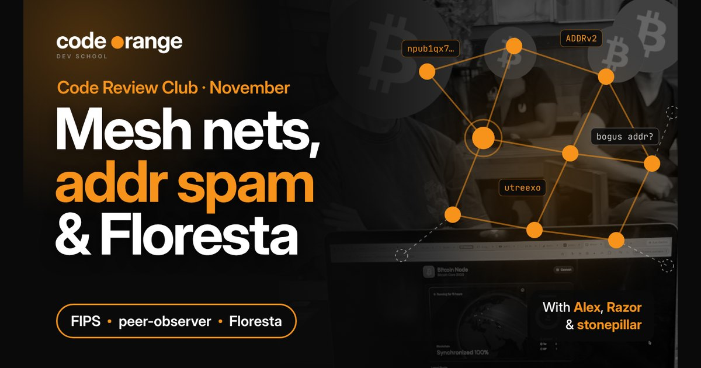
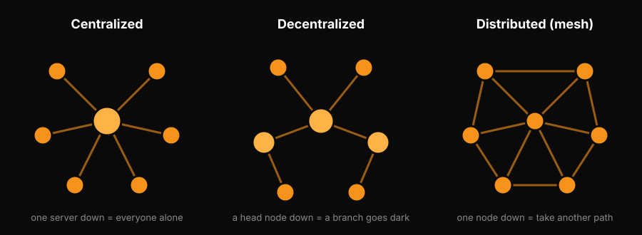
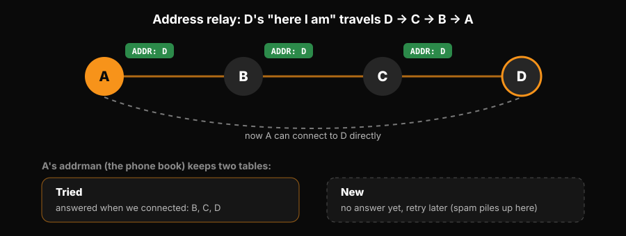

# Code Review Club: Mesh Networks, Address Spam and Floresta

**Date:** Thursday 12 November 2026
**Where:** Code Orange Dev School Discord
**Presenters:** Alex (FIPS), Razor (peer-observer case study), stonepillar (Floresta)
**Series:** Code Review Club (every 2nd Thursday of the month)
**Read on the website (with 3 mini-games):** https://codeorange.dev/session-notes/2026-11-12-code-review-club

▶ **[Watch the full recording on YouTube](https://www.youtube.com/watch?v=PplOYduOj3I)** (about 85 min)

> **TL;DR**
> - FIPS replaces IP addresses and DNS with keys you make yourself: every node's Nostr npub is its address, and messages find their way through a mesh over Wi-Fi, Bluetooth, radio or the internet.
> - Decentralized is not the same as distributed. If one node going down can cut off a branch, there is still a choke point. A true mesh has many paths.
> - Bitcoin nodes find each other by gossiping addresses into a phone book called addrman. In 2026 someone flooded it with fake addresses, and oddly, fewer real new addresses got in.
> - Floresta is a light Rust node that runs on a Raspberry Pi or a phone. stonepillar is spending his fellowship making its RPCs match Bitcoin Core, and there are first issues waiting for you.

Chapters (times taken from the transcript, may be slightly off)

- [00:00](https://www.youtube.com/watch?v=PplOYduOj3I&t=0s) FIPS: what it is and why it exists
- [02:25](https://www.youtube.com/watch?v=PplOYduOj3I&t=145s) What is a mesh network? Centralized vs decentralized vs distributed
- [10:06](https://www.youtube.com/watch?v=PplOYduOj3I&t=606s) Every node gets an identity: Nostr npubs
- [11:52](https://www.youtube.com/watch?v=PplOYduOj3I&t=712s) Why FIPS: getting around IP and DNS
- [12:39](https://www.youtube.com/watch?v=PplOYduOj3I&t=759s) One mesh, many links: Wi-Fi, Bluetooth, radio, LoRa
- [18:02](https://www.youtube.com/watch?v=PplOYduOj3I&t=1082s) Does FIPS still use IP? The OSI model
- [24:25](https://www.youtube.com/watch?v=PplOYduOj3I&t=1465s) Bitcoin scales in layers, like the internet
- [27:24](https://www.youtube.com/watch?v=PplOYduOj3I&t=1644s) Why VPNs and Tor are only workarounds
- [30:03](https://www.youtube.com/watch?v=PplOYduOj3I&t=1803s) IP addresses and domains need permission
- [31:41](https://www.youtube.com/watch?v=PplOYduOj3I&t=1901s) FIPS wrap-up and homework for next time
- [34:19](https://www.youtube.com/watch?v=PplOYduOj3I&t=2059s) Why we do these calls: more reviewers, more contributors
- [35:32](https://www.youtube.com/watch?v=PplOYduOj3I&t=2132s) Razor: a peer-observer case study
- [36:39](https://www.youtube.com/watch?v=PplOYduOj3I&t=2199s) Inside a node's address table (addrman)
- [39:13](https://www.youtube.com/watch?v=PplOYduOj3I&t=2353s) bnoc post: Address relay under stress
- [40:12](https://www.youtube.com/watch?v=PplOYduOj3I&t=2412s) ADDR and ADDRv2 messages explained
- [44:15](https://www.youtube.com/watch?v=PplOYduOj3I&t=2655s) Address relay for beginners (whiteboard)
- [50:55](https://www.youtube.com/watch?v=PplOYduOj3I&t=3055s) addrman is a phone book
- [53:28](https://www.youtube.com/watch?v=PplOYduOj3I&t=3208s) How this connects to peer-observer
- [57:05](https://www.youtube.com/watch?v=PplOYduOj3I&t=3425s) Addresses per ADDR message: before vs during the spam
- [62:24](https://www.youtube.com/watch?v=PplOYduOj3I&t=3744s) The attack: bogus addresses
- [64:16](https://www.youtube.com/watch?v=PplOYduOj3I&t=3856s) Why not just test every address first?
- [67:11](https://www.youtube.com/watch?v=PplOYduOj3I&t=4031s) The new and tried tables
- [69:18](https://www.youtube.com/watch?v=PplOYduOj3I&t=4158s) The puzzle: fewer new addresses during the spam
- [70:38](https://www.youtube.com/watch?v=PplOYduOj3I&t=4238s) stonepillar: hello, Floresta and the fellowship
- [76:33](https://www.youtube.com/watch?v=PplOYduOj3I&t=4593s) The Floresta repo: Rust, Utreexo, its own addrman
- [77:56](https://www.youtube.com/watch?v=PplOYduOj3I&t=4676s) Fix: anchors.json now survives a node shutdown
- [79:10](https://www.youtube.com/watch?v=PplOYduOj3I&t=4750s) Implementing Bitcoin Core's RPCs (good first issues)
- [80:15](https://www.youtube.com/watch?v=PplOYduOj3I&t=4815s) RPC authentication: why it is harder than it looks
- [83:03](https://www.youtube.com/watch?v=PplOYduOj3I&t=4983s) Wrap-up: Decoding Bitcoin and Privacy Track next week

## Play it

The website version has three mini-games: knock nodes out of a centralized, decentralized and distributed network, pass an ADDR message from node to node, and play addrman sorting a guest list into the tried and new tables. Then a 3-question quiz. https://codeorange.dev/session-notes/2026-11-12-code-review-club

## Highlights

### 1. FIPS with Alex

- **Your address is a key you make yourself.** Today you need an IP address from your internet provider and a domain name from a registry. Both are handed out from the top down, both reveal where you are, and both can be switched off. FIPS (Free Internetworking Peering System) gives every node its own key pair, and its Nostr npub is its address. Nodes find each other through a self-organizing mesh with no central server.

- **Decentralized is not distributed.** A question from the call. In a decentralized network, clusters hang off head nodes, so between two nodes there is often only one route: lose a head and a branch goes dark. In a distributed network every node has several paths. FIPS is the distributed kind, with no hierarchy: nodes compare addresses to build a spanning tree and pick a path.

  

- **Swap one layer, keep the rest.** FIPS only replaces the addressing layer of the network stack.

  | Layer | Internet today | With FIPS |
  |---|---|---|
  | Apps | Browser, chat, your server | Same apps, unchanged |
  | Transport | TCP / UDP | Same |
  | Addresses | IP from your ISP + DNS name | Your npub, made by you |
  | Links | Wi-Fi, Ethernet | Wi-Fi, Ethernet, Bluetooth, radio, LoRa |

- **VPNs and Tor are workarounds.** A VPN just hops your traffic through another company's servers, on IPs that are easy to recognise and block. FIPS tries to fix the root: a permissionless internet, like Bitcoin did for money. Alex met the creator, Jonathan, in Madeira, where Nostr developers had FIPS apps talking over Bluetooth.

> "You generate your identity yourself, instead of an IP address you have to request from your ISP." (Alex)

**Homework:** spin up a FIPS node before the next session. Alex will demo messaging between nodes from the terminal.

### 2. A peer-observer case study with Razor

- **Learn Bitcoin Core through real incidents.** peer-observer has no single starting point, so Razor starts from things that actually happened on the network. This one: the 2026 address spam, written up on bnoc as "Address relay under stress".

- **Address relay in one picture.** If nobody knows your node exists, nobody can connect to it. A new node tells its peers "here I am" in an ADDR message, and each node passes it on (never back to the sender). Every node stores what it hears in addrman, a phone book of addresses plus who told it. It stores no paths, just addresses you can connect to directly. Bitcoin Core keeps only the current phone book; peer-observer dumps it daily so you can see how it changes.

  

- **The spam.** An ADDR (or ADDRv2) message can carry up to 10 addresses. The average used to be about 2. From around April 2026 it climbed to about 3.5, because someone was flooding the network with bogus addresses until early August.

- **Why not test every address first?** Because honest nodes go offline. If your node crashes for an hour and everyone deletes it, it has to start gossiping from zero. So addrman keeps a **tried** table (answered when we connected) and a **new** table (not reached yet, retry later).

- **The puzzle.** During the spam, the number of new addresses added per day went **down**, not up. Razor ended there: "I hope by the end of my talk you will also be confused."

Spoiler: what the bnoc authors think

The spam filled the new table with fake entries that nodes could not easily evict, leaving little room for real new addresses. A follow-up post discusses relaxing the eviction rules, and the hard part: address gossip costs nothing to send, so spam is hard to price out.

### 3. Floresta with stonepillar

- **Meet our newest fellow.** stonepillar contributes to Floresta, a lightweight Bitcoin node in Rust that uses Utreexo so you can validate your own transactions on a Raspberry Pi or a phone. He is spending his three-month Code Orange fellowship on it.

- **Floresta teaches you Bitcoin Core.** It copies many of Core's parts, including its own address manager crate. A recent fix he reviewed: on shutdown, anchors.json (the node's best peers) was saved empty, so after a restart the node had to discover everyone again. Now the good peers survive a shutdown.

- **RPCs and authentication.** His main work is making Floresta's RPCs match Bitcoin Core's. There is a tracking issue full of RPCs still to build, good for first-time contributors. The biggest piece so far is RPC authentication (user and password or a cookie file), which needs many reviews because a mistake can leak information or even lose funds.

## Key takeaways

- **Distributed beats decentralized for resilience.** If one node going down can cut off a branch, there is still a choke point.
- **Learn Bitcoin Core through incidents.** Address relay is just nodes gossiping into a phone book. The spam shows why it needs a forgiving "new" table, and how that table can get clogged.
- **There is real work waiting for you.** Floresta has RPCs to build and PRs to review. Reviewing is how you start.

## Test yourself

1. In FIPS, what is a node's address?
2. Your node gets an address but can't connect to it. What does Bitcoin Core do?
3. What did stonepillar's anchors.json fix in Floresta do?

Answers

1. Its Nostr npub, a key the node makes itself. Every FIPS node generates its own key pair. The public key (npub) is its address, so nobody has to hand you one.
2. Keeps it in the new table and tries again later. Honest nodes go offline sometimes. Deleting them would force them to start gossiping from zero, so addrman is forgiving.
3. Made the node remember its good peers across a shutdown. Before the fix the file was saved empty on shutdown, so the node had to find peers all over again on restart.

## Resources shared

### FIPS and mesh networking

- [FIPS (Free Internetworking Peering System)](https://github.com/jmcorgan/fips) (Jonathan Corgan): the project Alex presented: a self-organizing, encrypted mesh network where every node's address is its Nostr npub. Alex's homework: run a node before next time
- [BitChat](https://bitchat.free): the example Alex used for chatting over Bluetooth with no internet. FIPS wants to make that kind of link work for any app
- [OSI model](https://en.wikipedia.org/wiki/OSI_model): the seven-layer picture of a network that came up when we asked whether FIPS still uses IP. FIPS swaps out the addressing layer

### Address relay

- [Address relay under stress](https://mirror.b10c.me/bnoc-xyz/2026-08-14-address-relay-under-stress-id163.html) (bnoc, August 2026): the forum post Razor walked through: the address spam from about April to July 2026 and how it showed up in peer-observer data
- [Address relay under stress: attack characteristics and measuring its effects](https://mirror.b10c.me/bnoc-xyz/2026-08-14-address-relay-under-stress-attack-characteristics-and-measuring-its-effects-id164.html) (bnoc, August 2026): the companion post with the graphs, including new addresses per day falling during the spam
- [Peer Observer](https://github.com/0xB10C/peer-observer) (0xB10C): tools that watch the Bitcoin P2P network for attacks. It dumps a node's addrman every day so you can see how it changes
- [Bitcoin Core addrman.h](https://github.com/bitcoin/bitcoin/blob/master/src/addrman.h): where address relay lives in Bitcoin Core, with addrman_impl.h and the matching .cpp files. Start with the comments at the top
- [Address relay (Bitcoin Core Academy)](https://bitcoincore.academy/address-relay.html): a plain-English chapter on how nodes share addresses, if you want more after the whiteboard

### Floresta

- [Floresta](https://github.com/vinteumorg/Floresta): the lightweight Utreexo node in Rust that stonepillar contributes to. Look for the RPC tracking issue if you want a first contribution
- [Utreexo](https://dci.mit.edu/utreexo) (Tadge Dryja, MIT DCI): the idea that lets Floresta keep a tiny summary of the coin set instead of the whole database

### Code Orange

- [Decoding Bitcoin cohort](https://codeorange.dev/decoding-bitcoin): 10 weeks, every Monday, starting 16 November. Alex runs it
- [Privacy Track](https://codeorange.dev/privacy-track): next up: Silent Payments on Tuesday 17 November, with a wallet demo
- [Developer fellowship](https://codeorange.dev/fellowships): how stonepillar is spending three months on Floresta

Also mentioned without a link: Jeff Booth's point that Bitcoin scales in layers like the internet (Lightning, ecash, Nostr on top), FIPS's encryption saved for a later session, and the RPC authentication PR on Floresta that is close to merging. stonepillar will bring Floresta PRs to future Code Review Clubs.

## Next sessions

- **Decoding Bitcoin cohort:** starts Monday 16 November, 7pm UTC+8 on Discord. https://codeorange.dev/decoding-bitcoin
- **Privacy Track, Silent Payments:** Tuesday 17 November, 07:00 UTC on Discord, with a wallet demo. https://codeorange.dev/privacy-track
