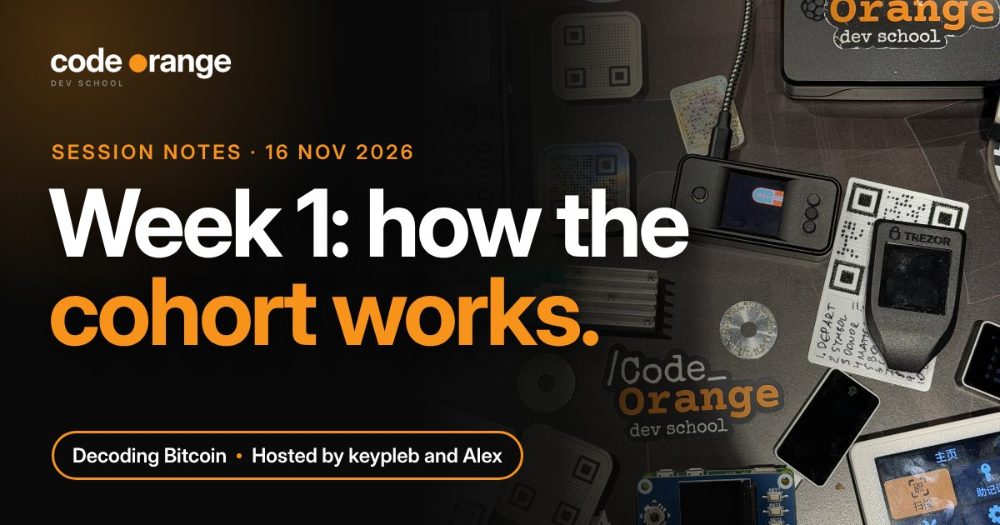
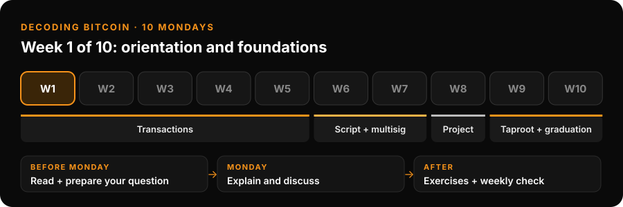
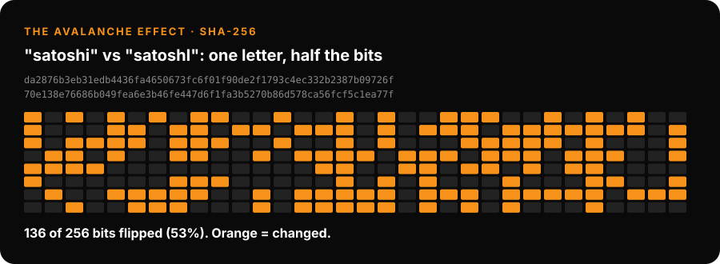

# Decoding Bitcoin Week 1: How the Cohort Works

**Date:** Monday 16 November 2026, 11:00 UTC (7pm UTC+8)
**Where:** Code Orange Dev School Discord
**Hosts:** keypleb and Alex, with Razor on the BOSS Challenge
**Series:** Decoding Bitcoin, a free 10-week study cohort (every Monday until 18 January 2027)
**Read on the website (with 4 mini-games and 6 badges):** https://codeorange.dev/session-notes/2026-11-16-decoding-bitcoin-week-1

▶ **[Watch the full recording on YouTube](https://www.youtube.com/watch?v=VIfltkAznTA)** (about 50 min)

> **TL;DR**
> - Decoding Bitcoin is 10 Mondays, 90 minutes each, cameras off for privacy. Transactions first, then script and multisig, your own project, Taproot, and a graduation.
> - The certificate is for showing up and doing the work: attend, do the exercises (they count, the slide saying optional was a mistake) and the weekly check. Can't make it live? Post your homework on Discord and it still counts.
> - Everyone gets one discussion question for next Monday, by Discord tag and email. You explain it to the group, because the teacher learns the most.
> - Decoding Bitcoin by The Bitcoin Dev Project is the source of truth for lessons and exercises. Your dashboard is a personal link with no login, so save it.

Chapters (times taken from the transcript, may be slightly off)

- [00:00](https://www.youtube.com/watch?v=VIfltkAznTA&t=0s) Welcome, cameras off, the 10-week plan
- [01:30](https://www.youtube.com/watch?v=VIfltkAznTA&t=90s) Exercises, weekly check-ins and the certificate
- [02:30](https://www.youtube.com/watch?v=VIfltkAznTA&t=150s) Attendance, study buddies and getting help
- [04:00](https://www.youtube.com/watch?v=VIfltkAznTA&t=240s) Q&A: can you join without coming live?
- [05:29](https://www.youtube.com/watch?v=VIfltkAznTA&t=329s) Tour of the cohort dashboard
- [08:29](https://www.youtube.com/watch?v=VIfltkAznTA&t=509s) Discussion questions: one each for next Monday
- [10:29](https://www.youtube.com/watch?v=VIfltkAznTA&t=629s) Screen share: the Decoding Bitcoin quiz
- [12:29](https://www.youtube.com/watch?v=VIfltkAznTA&t=749s) After Decoding Bitcoin: the BOSS Challenge
- [13:20](https://www.youtube.com/watch?v=VIfltkAznTA&t=800s) Razor on what BOSS is really like
- [16:21](https://www.youtube.com/watch?v=VIfltkAznTA&t=981s) Alex on BOSS: hours, workload, dropouts
- [19:50](https://www.youtube.com/watch?v=VIfltkAznTA&t=1190s) Back to the quiz: change one letter, change half the hash
- [21:50](https://www.youtube.com/watch?v=VIfltkAznTA&t=1310s) Where the exercises live and how questions get assigned
- [26:39](https://www.youtube.com/watch?v=VIfltkAznTA&t=1599s) How the weekly discussion works
- [27:50](https://www.youtube.com/watch?v=VIfltkAznTA&t=1670s) Plan: Decoding Bitcoin site for exercises, our dashboard for questions
- [34:03](https://www.youtube.com/watch?v=VIfltkAznTA&t=2043s) How to prepare for next Monday
- [39:03](https://www.youtube.com/watch?v=VIfltkAznTA&t=2343s) Why your dashboard has no login
- [42:43](https://www.youtube.com/watch?v=VIfltkAznTA&t=2563s) The Decoding Bitcoin site is the source of truth
- [43:43](https://www.youtube.com/watch?v=VIfltkAznTA&t=2623s) Remember why you are here
- [44:43](https://www.youtube.com/watch?v=VIfltkAznTA&t=2683s) Homework and wrap-up
- [48:11](https://www.youtube.com/watch?v=VIfltkAznTA&t=2891s) Tomorrow: Privacy Track on Silent Payments

## Before next Monday

- [ ] Save your personal dashboard link somewhere safe. There is no login: the link is your key. https://codeorange.dev/decoding-bitcoin/me
- [ ] Watch Discord and your email for your assigned discussion question, and prepare to explain it in your own words.
- [ ] Read the week 1 lessons: [Welcome](https://bitcoindevs.xyz/decoding/welcome), [Bitcoin History](https://bitcoindevs.xyz/decoding/bitcoin-history), [UTXO vs Account Models](https://bitcoindevs.xyz/decoding/utxo).
- [ ] Try the exercises: say hi in the cohort channel, play with the [Hash Functions tool](https://bitcoindevs.xyz/decoding/hash-functions), pick apart one transaction on [mempool.space](https://mempool.space).
- [ ] Do the [weekly check](https://codeorange.dev/decoding-bitcoin/check): five questions, two minutes.
- [ ] DM one classmate on Discord. Find your study buddy.

## Play it

The website version has four mini-games: change one letter and watch a real SHA-256 hash flip half its bits, put DigiCash, b-money, Bit Gold and Bitcoin in order, find your lane by hours per week, and spin for a practice discussion question. Plus a homework checklist and a 4-question quiz. https://codeorange.dev/session-notes/2026-11-16-decoding-bitcoin-week-1

## Highlights

### 1. Ten Mondays, one plan

- **We are here to understand how Bitcoin actually works.** Five weeks on transactions (how one lives, byte by byte, building, fees, signing), then script and multisig, a week to build or vibe code your own project, and Taproot, followed by a graduation and certificates.

  

- **The certificate is for doing the work.** Attendance matters, because we keep each other accountable, so book Mondays and say so if you have to miss one. The exercises count too: a slide called them optional, which was a mistake. They can get advanced, so take your time.
- **Can't come live? You can still earn it.** Asked on the call: what about people who do the homework and post it on Discord but can't join live? Yes, that counts. You can exceed expectations without ever being on the call.
- **Just want to hang out?** Also fine. No certificate without the exercises, but you are welcome every Monday.

### 2. Your dashboard, no login

- **Sign up once, get a personal link.** 25 people signed up before the first call. Your dashboard shows this week's lessons, your assigned question, exercises to tick off and the five-question weekly check.
- **Why no password.** The first version used a Nostr login and it added friction. Now the dashboard is a personal URL you save. No accounts, minimal friction.
- **Built with AI, shaped by you.** The dashboard was vibe coded with Claude and is brand new. Feedback goes straight into the next version.

> "Help me help you build an even better dashboard." (keypleb)

### 3. One letter, half the hash

Alex worked through the Decoding Bitcoin quiz on screen. Everything green until one question: what happens to a hash when you change a single letter? Not just the last few characters. Roughly **half of all 256 bits flip**: the avalanche effect. That is why a hash gives away nothing about how close two inputs are.

### 4. What comes after: the BOSS Challenge

- **Decoding Bitcoin is a gentle start. BOSS is the deep end.** The Bitcoin Open Source Software Challenge from Chaincode Labs wants to turn you into an open source contributor fast. Another round is coming next year.
- **Razor's version:** month 1 is challenges (implement a transaction, Taproot, a way to spend it), month 2 a personal project for your portfolio, month 3 contributing to a real project. "There's no end to the challenge, actually."
- **It is a lot of work.** Alex started BOSS in January and did not finish: 5 to 10 hours a day in month one, like a full-time job. Razor finished, and less than a year after getting curious about Bitcoin is now a full-time developer and Code Orange educator fellow. Decoding Bitcoin is more like 2 to 5 hours a week.
- **Dropout is normal.** Our last study cohort, rawBit, had 20 sign-ups and two finishers. A handful of graduates is a success.

### 5. Next Monday: you teach

Week 1 has six discussion questions. Each person gets one, tagged on Discord and by email (if you signed up on the site). Next Monday you get called on to explain it. Get question 4 and you will have to put the UTXO model in your own words. The teacher learns the most.

1. What problem did Bitcoin solve that earlier digital cash attempts (DigiCash, b-money, Bit Gold) could not?
2. Pick one moment from the Bitcoin History lesson and explain why it mattered for how Bitcoin works today.
3. What is a hash function? Name three properties Bitcoin relies on and where each one shows up.
4. Explain the UTXO model in your own words. Why is there no account balance stored anywhere?
5. Give one advantage and one disadvantage of UTXOs compared with an account model.
6. Why do people say "don't trust, verify"? What can you verify yourself, and what do you usually take on trust?

Exercises live on Decoding Bitcoin by The Bitcoin Dev Project: "the Decoding Bitcoin website is the truth".

## Key takeaways

- **Keep it simple.** One question, one Monday, one set of exercises at a time.
- **Showing up is the skill.** Live or async through Discord, the people who keep coming are the ones who finish.
- **Remember why you are here.** A Bitcoin job, a fellowship, your own project, a future co-founder on the call, or just understanding how it works. All valid. Meet people and DM each other.

## Test yourself

1. You can't make it to the live call. Can you still earn the certificate?
2. You hash a word with SHA-256, then change one letter. How much of the output changes?
3. How do you log in to your dashboard?
4. Where do the lessons and exercises live?

Answers

1. Yes, if you do the work and post your homework on Discord.
2. About half of the 256 bits: the avalanche effect.
3. You don't. You open your personal link, so save it.
4. On Decoding Bitcoin by The Bitcoin Dev Project (bitcoindevs.xyz/decoding).

## Resources shared

### The course

- [Decoding Bitcoin](https://bitcoindevs.xyz/decoding) (The Bitcoin Dev Project): the interactive course we follow for 10 weeks. Our source of truth
- [Week 1 lesson: Bitcoin History](https://bitcoindevs.xyz/decoding/bitcoin-history): from DigiCash, b-money and Bit Gold to the whitepaper
- [Week 1 lesson: UTXO vs Account Models](https://bitcoindevs.xyz/decoding/utxo): why Bitcoin tracks coins, not balances
- [Tool: Hash Functions](https://bitcoindevs.xyz/decoding/hash-functions): change one letter, watch half the output change

### Reading and tools

- [Mastering Bitcoin](https://github.com/bitcoinbook/bitcoinbook) (Andreas M. Antonopoulos and David A. Harding): the classic technical book, free on GitHub
- [mempool.space](https://mempool.space): block explorer for this week's transaction exercise

### What comes next

- [BOSS Challenge](https://bosschallenge.xyz) (Chaincode Labs): three months to become a Bitcoin open source contributor

### Code Orange

- [Decoding Bitcoin cohort](https://codeorange.dev/decoding-bitcoin): sign up (late joiners welcome)
- [Weekly plan](https://codeorange.dev/decoding-bitcoin/curriculum): all 10 weeks of lessons, questions and exercises
- [Weekly check](https://codeorange.dev/decoding-bitcoin/check): five questions a week
- [Privacy Track](https://codeorange.dev/privacy-track): Silent Payments on Tuesday 17 November

## Next sessions

- **Privacy Track, Silent Payments:** Tuesday 17 November, 07:00 UTC on Discord. https://codeorange.dev/privacy-track
- **Decoding Bitcoin week 2, How a transaction lives:** Monday 23 November, 7pm UTC+8 on Discord. Bring your answer to your assigned question.

## Join the cohort: it's not too late

Decoding Bitcoin is free, runs every Monday on Discord, and you can join at any time. Sign up in 30 seconds, catch up with the recaps and come to the next session.

**[Register free →](https://codeorange.dev/decoding-bitcoin#signup)**

---
Notes by Code Orange Dev School. Free to share and reuse (CC0). Join us on [Discord](https://codeorange.dev).
