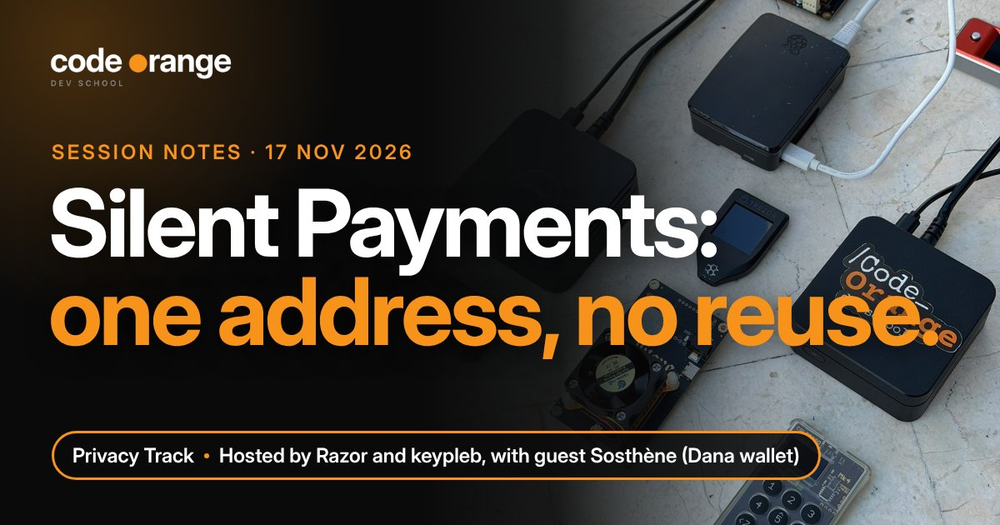
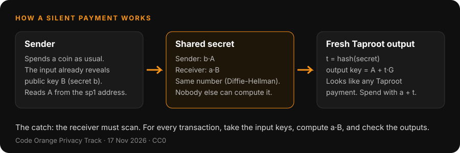

# Privacy Track: Silent Payments, One Address, No Reuse

**Date:** Tuesday 17 November 2026, 07:00 UTC
**Where:** Code Orange Dev School Discord
**Hosts:** Razor (deep dive and quiz) and keypleb, with guest speaker Sosthène, developer of the Dana wallet
**Read on the website (with 4 mini-games and 6 badges):** https://codeorange.dev/session-notes/2026-11-17-privacy-track-silent-payments

Recording coming soon.

> **TL;DR**
> - A silent payment address starts with `sp1` and can be posted anywhere. Every payment to it lands on a different, normal-looking Taproot output, so nobody can list your payments.
> - It fixes address reuse, the baseline privacy leak. It does not stop chain analysis if you later merge those coins, so pair it with coin control, PayJoin and other tools.
> - Sending is easy and needs no node. Receiving is the hard part: your wallet has to scan every transaction, and how it scans (full node, Electrum server, BlindBit) decides what you leak and how fast you see payments.
> - The projects are run by very few people: Dana, BlindBit Oracle, Frigate and Shroud all welcome new contributors.

Chapters (times taken from the transcript, may be slightly off)

- 00:00 Welcome and the plan for today
- 04:47 Live demo: Cake Wallet to Shroud, then mempool.space
- 09:00 Why some wallets see a payment sooner: scanning
- 11:47 Address reuse, and what silent payments don't fix
- 20:33 Spot the silent payment: Taproot outputs and round amounts
- 30:38 Backends: Electrum servers vs BlindBit
- 41:52 Gap limits, with a real wallet recovery story
- 45:57 Razor's deep dive: history and the interactivity scale
- 52:16 Sender vs receiver: why scanning is the hard part
- 54:12 Building silent payments from scratch
- 1:10:06 Quiz
- 1:19:12 How to contribute: Dana, BlindBit, Frigate, Shroud
- 1:23:00 Wrap-up and what's next

## Try it before next time

- [ ] Get a silent payment address (starts with `sp1`) in Cake Wallet, Sparrow, Dana or Shroud.
- [ ] Send a few thousand sats to it and look the transaction up on [mempool.space](https://mempool.space). Can you tell it apart from a normal Taproot payment?
- [ ] Read the overview on [silentpayments.xyz](https://silentpayments.xyz). Brave? Open BIP 352.
- [ ] Pick one project (Dana, BlindBit Oracle, Frigate or the Shroud indexer), build it and run it.

## Play it

The website version has four mini-games: run a donation page and play the spy, be the chain analyst (which output is the payment?), pick a scanning backend for three different people, and rebuild silent payments from scratch in five steps. Plus a 5-question quiz. https://codeorange.dev/session-notes/2026-11-17-privacy-track-silent-payments

## Highlights

- **A real payment, nothing to see.** keypleb got an `sp1` address from the Shroud wallet, paid 20,000 sats to it from Cake Wallet, and looked it up on mempool.space: two inputs, two outputs, one plain Taproot (`v1_p2tr`) output. The `sp1` address never shows up on chain. Publish one address forever; every payment lands somewhere new.
- **Why address reuse is so bad.** Sosthène and Razor showed donation pages with a plain Bitcoin address. Paste one into a block explorer and you see every donation since 2020 (17+ BTC) and where the coins went next. Reuse hurts everyone who pays you too, not just you.

  > "If you reuse addresses, you're done. No matter what you do after that, there's no way to have good privacy." (Sosthène, Dana wallet)

- **Spot the payment.** The giveaway in the demo wasn't the Taproot output, it was the amount: exactly 20,000 sats (human-typed) vs 3,026 sats change. Analysts also convert outputs to fiat at the time and look for round numbers. Tip: when you ask to be paid, add a few random sats.
- **Scanning is the hard part.** Sending needs no node. Receiving means checking every transaction. A full node is most private. Electrum-style servers (Cake Wallet; Frigate behind Sparrow) see mempool payments fast but learn which outputs are yours. BlindBit Oracle (Dana) serves the same public data to everyone, so it learns very little, but today you wait for a block. Along the way: a real story of "missing" bitcoin that turned out to be a wallet's gap limit.
- **Razor rebuilt the protocol from scratch.** Starting from tweaked keys: (1) send the tweak privately, too interactive; (2) put the tweak on chain, but then anyone who knows the address can link it; (3) use Diffie-Hellman so only sender and receiver share the secret; (4) take the sender's key from the input they already spend, so nothing extra goes on chain; (5) use a Taproot output so it looks like every other payment. The cost of zero interaction: the receiver scans.

**Interactivity scale** (least to most): silent payments (post one address) → a fresh address per payer (HD wallet, BTCPay Server) → PayJoin (new address, PSBT back and forth, relay and mailbox directory).

## Key takeaways

1. **Never reuse an address.** It leaks your history and everyone else's. A silent payment address is the one you can safely post on a website.
2. **One layer, not the whole stack.** Silent payments fix the baseline. Don't merge those coins carelessly, avoid round amounts, and add PayJoin and coin control.
3. **Scanning is the frontier.** How a wallet finds its payments decides speed and privacy, and it is exactly where the projects need developers.

## Test yourself

1. Does the sender have to notify the receiver before paying?
No. The receiver finds the payment by scanning. (BIP 47 needed a notification transaction.)

2. Which leak do silent payments protect against?
Destination address reuse. Breaking the common input heuristic is PayJoin's job.

3. What output type does a silent payment create?
Pay to Taproot (P2TR).

4. What is the biggest trade-off?
The receiver has to do much more work to scan for payments. Senders need no full node.

5. 20,000 sats paid, 3,026 sats change. What gives the payment away?
The round amount.

## Resources shared

**Reading**
- [BIP 352: Silent Payments](https://github.com/bitcoin/bips/blob/master/bip-0352.mediawiki), Josie Baker and Ruben Somsen: the spec, built up step by step
- [silentpayments.xyz](https://silentpayments.xyz): the best place to start (overview, wallets, docs)
- [BIP 47: Reusable payment codes](https://github.com/bitcoin/bips/blob/master/bip-0047.mediawiki): older scheme (Samourai) that needs a notification transaction
- [BIP 351: Private Payments](https://github.com/bitcoin/bips/blob/master/bip-0351.mediawiki): an alternative that relies on OP_RETURN

**Wallets**
- [Dana wallet](https://github.com/cygnet3/danawallet): donations wallet built on silent payments and BlindBit, by our guest. Looking for contributors
- [Cake Wallet](https://cakewallet.com): sends and receives silent payments; used in the demo
- [Sparrow Wallet](https://sparrowwallet.com): recently added sending and receiving, via Frigate
- Shroud: non-custodial mobile wallet with silent payments, used in the demo

**Tools**
- [BlindBit Oracle](https://github.com/setavenger/blindbit-oracle): privacy-friendly silent payments indexing server
- [Frigate](https://github.com/sparrowwallet/frigate), Craig Raw: Electrum server for silent payments
- [Shroud indexer](https://github.com/CypherCommons/shroud-indexer): the silent payments indexer behind Shroud
- [mempool.space](https://mempool.space): where we looked up the demo payment

**Code Orange**
- [Silent Payments lab](https://github.com/code-orange-dev/curriculum/tree/main/privacy-track/labs/silent-payments) from our Privacy Track curriculum
- [Privacy Track](https://codeorange.dev/privacy-track): every 1st and 3rd Tuesday, 07:00 UTC. Next: Tuesday 1 December
- [Developer fellowship](https://codeorange.dev/fellowships): paused for now; build proof of work on these projects in the meantime
- Previous Privacy Track: [PayJoin v2, tested live](2026-10-20-privacy-track.md)

---
Notes by Code Orange Dev School. Join us on [Discord](https://codeorange.dev).
