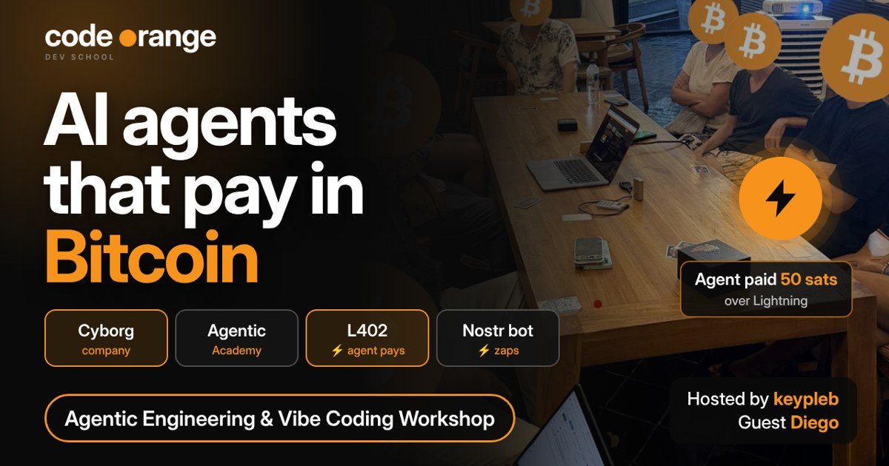

# Agentic Engineering & Vibe Coding Workshop: AI agents that pay in Bitcoin

**Date:** Wednesday 18 November 2026, 12:00 UTC
**Where:** Code Orange Dev School Discord
**Host:** keypleb, with guest Diego
**Read on the website:** https://codeorange.dev/session-notes/2026-11-18-agentic-engineering

**Recording:** https://youtu.be/nCGUOUqmgGc

> **TL;DR**
> - Agents can now hold and spend money: on the call an agent bought five pieces of live Bitcoin data for 10 sats each over Lightning, using L402.
> - Diego's "cyborg company" puts AI agents at desks in a 3D office. They raise a hand when they need a human, and the human signs off with a passkey.
> - Show your work to win work: an open lab of experiments is Diego's portfolio, and one small-business rebuild became a case study for the next client.
> - L402 is still experimental. Homework: build something small that uses it and show it next month.

## Highlights

- **Diego's open lab: agent sessions you can read like a night sky.** Guest speaker Diego (Argentina, 15 years in IT) built everything he showed with Claude Code. His open lab draws each coding-agent session as a galaxy: the orchestrator in the middle, sub-agents around it, tools and hooks firing as lights. A lot of red means too many guardrails are firing and the work is stuck. The lab also has a protocols lab (MCP, agent to user, agent to agent, agent to business), an x402 pay-per-call lab on a testnet, and Agentic Academy: free, open courses with no login and no ads. The lab is free, and it works as his portfolio. "You have to give something away in order to have something in return."

- **A cyborg company: agents at desks, humans accountable.** Diego's startup shows a business as 3D buildings with departments inside. Each desk has an agent with a face and a job. When an agent needs a decision (for example, it created a refund) it raises its hand, and a human reviews and signs with a passkey. Guardrails today: hard budget caps per department and hooks that stop an agent when a rule is broken. Agents do not send payments yet. The money they spend is model tokens.

- **An agent pays for data over Lightning.** keypleb vibe coded a demo before the call. The agent's job: write a live Bitcoin network briefing. It needs five answers (block height, fees, price, mempool, hashrate) at 10 sats each. A phone wallet paid a 50-sat invoice and the agent bought each answer by itself with L402: ask, get a 402 with an invoice, pay, show proof, get the data. No account, no card, no API key. Try it: https://codeorange.dev/agent-pay

- **A meme bot that earns zaps.** A Nostr account posts memes made by an agent, with a Lightning address on its profile. Zap it and the sats land in an ecash wallet.

> "I feel like it's more experimental, and it's up to us to make it mainstream." (keypleb, on L402)

## Key takeaways

1. **Agents can already hold and spend sats.** Paying per call fits how agents work: model calls, data feeds, web search, compute, paywalled content, even a tiny fee to keep spam away.
2. **Keep a human accountable.** Budget caps, hooks that block broken rules, and a signature for anything that matters.
3. **Show your work to win work.** Diego's lab is his portfolio. One small-business rebuild with an agent became the pitch for the next client.

Chapters (times from the transcript, may be slightly off)

- [0:00](https://www.youtube.com/watch?v=nCGUOUqmgGc&t=0s) Welcome and plan for today
- [2:26](https://www.youtube.com/watch?v=nCGUOUqmgGc&t=146s) Intros: how everyone uses AI
- [5:35](https://www.youtube.com/watch?v=nCGUOUqmgGc&t=335s) Community demo: an AI Mandarin speaking tutor
- [17:09](https://www.youtube.com/watch?v=nCGUOUqmgGc&t=1029s) The dream: "Claude, earn me $100 while I sleep"
- [19:13](https://www.youtube.com/watch?v=nCGUOUqmgGc&t=1153s) Diego joins: 15 years in IT, from Argentina
- [20:02](https://www.youtube.com/watch?v=nCGUOUqmgGc&t=1202s) Paxel: a profile of how you build with agents
- [22:05](https://www.youtube.com/watch?v=nCGUOUqmgGc&t=1325s) Open lab: Claude Code sessions as constellations
- [26:04](https://www.youtube.com/watch?v=nCGUOUqmgGc&t=1564s) The same idea for LangGraph and LangSmith
- [26:31](https://www.youtube.com/watch?v=nCGUOUqmgGc&t=1591s) How a lab wins clients: show your skills
- [27:55](https://www.youtube.com/watch?v=nCGUOUqmgGc&t=1675s) Story: AI as CTO and marketing team for a small business
- [29:37](https://www.youtube.com/watch?v=nCGUOUqmgGc&t=1777s) Agentic protocols lab: MCP, agent-to-agent, agent-to-business
- [31:14](https://www.youtube.com/watch?v=nCGUOUqmgGc&t=1874s) x402 pay-per-call lab
- [34:17](https://www.youtube.com/watch?v=nCGUOUqmgGc&t=2057s) Agentic Academy: free, open agent courses
- [37:06](https://www.youtube.com/watch?v=nCGUOUqmgGc&t=2226s) "Vibe coding" is now agentic engineering
- [37:10](https://www.youtube.com/watch?v=nCGUOUqmgGc&t=2230s) Diego's startup: a cyborg company run by agents
- [39:06](https://www.youtube.com/watch?v=nCGUOUqmgGc&t=2346s) Human in the loop: approvals with passkeys
- [45:27](https://www.youtube.com/watch?v=nCGUOUqmgGc&t=2727s) Q&A: guardrails when agents move money
- [50:41](https://www.youtube.com/watch?v=nCGUOUqmgGc&t=3041s) How L402 could fit a cyborg company
- [54:55](https://www.youtube.com/watch?v=nCGUOUqmgGc&t=3295s) Live demo: an agent pays for data over Lightning (L402)
- [60:12](https://www.youtube.com/watch?v=nCGUOUqmgGc&t=3612s) Use cases for agent payments
- [62:09](https://www.youtube.com/watch?v=nCGUOUqmgGc&t=3729s) How L402 works: a robot at the shop
- [65:04](https://www.youtube.com/watch?v=nCGUOUqmgGc&t=3904s) Will the agent economy beat the human economy?
- [65:58](https://www.youtube.com/watch?v=nCGUOUqmgGc&t=3958s) Q&A: is anyone using L402 for real yet?
- [68:36](https://www.youtube.com/watch?v=nCGUOUqmgGc&t=4116s) A Nostr meme bot that earns zaps
- [70:06](https://www.youtube.com/watch?v=nCGUOUqmgGc&t=4206s) Learning resources and the tools Diego uses
- [72:50](https://www.youtube.com/watch?v=nCGUOUqmgGc&t=4370s) How Code Orange uses Claude
- [76:21](https://www.youtube.com/watch?v=nCGUOUqmgGc&t=4581s) How to reach Diego
- [78:22](https://www.youtube.com/watch?v=nCGUOUqmgGc&t=4702s) Wrap-up and next sessions

## Homework

- [ ] Open the [agent pay demo](https://codeorange.dev/agent-pay) and run it once in practice mode.
- [ ] Run [Paxel](https://paxel.ycombinator.com) on your own agent sessions and see how you really work.
- [ ] Build one small thing where an agent pays or gets paid in sats, and show it at the next workshop.

## Test yourself

1. **What does a server answer when an agent asks for paid data with L402?**
   - a) 200 OK, pay later
   - b) 402 Payment Required, with a Lightning invoice
   - c) A login page
   

Answer
b) 402 Payment Required, with a Lightning invoice. The agent pays the invoice and comes back with proof of payment. No account, no card.

2. **In the cyborg company, what happens when an agent wants to issue a refund?**
   - a) It just sends the money
   - b) It raises its hand and a human approves with a passkey
   - c) It emails the customer first
   

Answer
b) It raises its hand and a human approves with a passkey. That is the human in the loop: a person stays accountable for the decision.

3. **Is L402 mainstream yet?**
   - a) Yes, most APIs use it
   - b) No, it is still experimental and up to builders to try
   - c) It was shut down
   

Answer
b) No, it is still experimental and up to builders to try. Nobody on the call knew a mainstream product using it. That is the opportunity.

4. **How does Diego use his free open lab?**
   - a) He sells tickets to it
   - b) As a showcase: clients see it and ask for the same in their company
   - c) He does not share it
   

Answer
b) As a showcase: clients see it and ask for the same in their company. You have to give something away to get something back.

## Resources shared

**Reading**
- [L402](https://docs.lightning.engineering/the-lightning-network/l402), Lightning Labs: the protocol behind the demo: an HTTP 402 "payment required" answer, a Lightning invoice, and a token that proves you paid
- [Lightning agent tools](https://lightning.engineering/posts/2026-02-11-ln-agent-tools/), Lightning Labs (2026): "The agents are here and they want to transact": the toolkit that Pi402 and the Wavelength wallet build on
- [x402](https://www.x402.org): pay-per-call for agents over HTTP 402 with stablecoins; Diego's lab runs it on a testnet next to MCP-style protocols
- [Model Context Protocol (MCP)](https://modelcontextprotocol.io): the standard way to give an agent tools; one of the protocols animated step by step in Diego's protocols lab

**Tools**
- [Agent pay demo](https://codeorange.dev/agent-pay), Code Orange: the demo from the call: an agent buys five pieces of live Bitcoin data for 10 sats each over Lightning, with real sats or in practice mode
- [Paxel](https://paxel.ycombinator.com), Y Combinator: free tool that reads your local Claude Code, Codex or Cursor sessions and gives you a profile of how you build with agents
- [Claude Code](https://claude.com/product/claude-code), Anthropic: the coding agent Diego used for everything he showed, about 95% of the time in the desktop app
- [LangGraph](https://www.langchain.com/langgraph), LangChain: agent framework; Diego built a second constellation view on top of its tracing tool, LangSmith
- [OpenRouter](https://openrouter.ai): one API for many models, with free tiers; used as a fallback in Diego's projects and for the Mandarin tutor
- [Antigravity](https://antigravity.google), Google: agent-first code editor one developer uses for projects he does not plan to maintain by hand

**Wallets**
- [Minibits](https://www.minibits.cash): ecash wallet with a Lightning address; it receives the sats in the agent pay demo and the meme bot's zaps
- [Cashu.me](https://cashu.me): ecash wallet in the browser, used for the 21-sat zap test
- [Wallet of Satoshi](https://www.walletofsatoshi.com): the phone wallet that paid the 50-sat invoice live on the call

**Code Orange**
- [BOSS Challenge](https://bosschallenge.xyz): free Bitcoin open-source challenge; the next one starts in January
- [Agentic Engineering workshop](https://codeorange.dev/programs/agentic-engineering): every 3rd Wednesday, 12:00 UTC on Discord. Build something and show it next month
- [Decoding Bitcoin cohort](https://codeorange.dev/decoding-bitcoin): Mondays 7pm UTC+8 on Discord, join any week

Also on the call: a community member showed a voice tutor she built to practise Mandarin, with ChatGPT for the logic, Gemini for the design and free model keys from OpenRouter. Ideas for next time: pay 21 sats over L402 to join a workshop, a paywalled Substack-style page on Nostr, and an L402 experiment inside Diego's cyborg company with Code Orange as a design partner.

**Next:** Decoding Bitcoin, week 2. Monday 23 November, 7pm UTC+8 on Discord. Free, join any week. The next Agentic Engineering workshop is Wednesday 16 December, 12:00 UTC.

---
Notes by Code Orange Dev School. Join us on [Discord](https://codeorange.dev).
