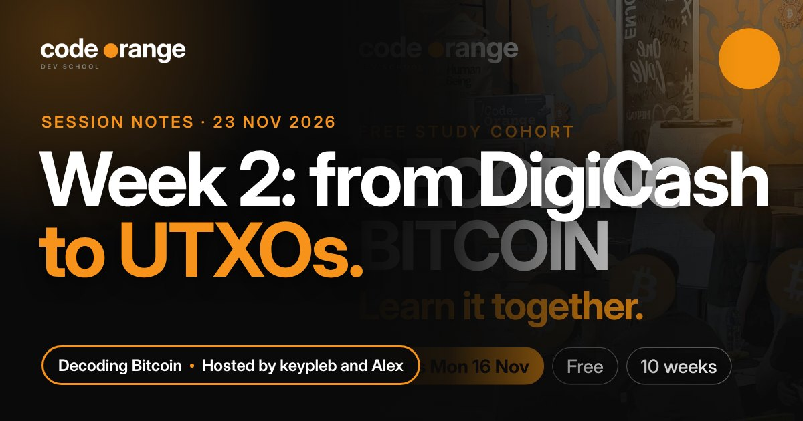
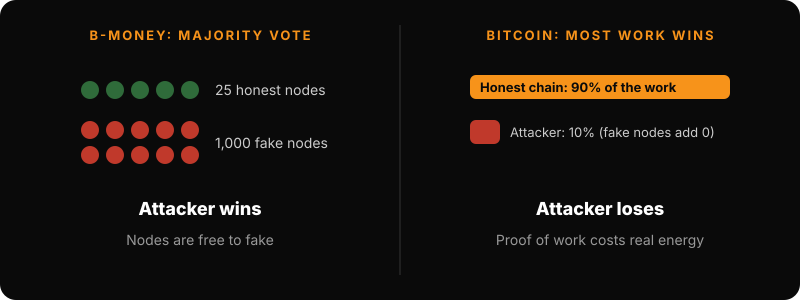
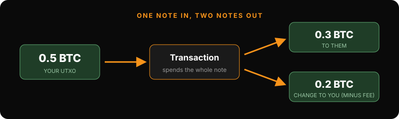

# Decoding Bitcoin Week 2: From DigiCash to UTXOs

**Date:** Monday 23 November 2026, 11:00 UTC (7pm UTC+8)  
**Where:** Code Orange Dev School Discord  
**Hosts:** keypleb and Alex, with Razor  
**Series:** Decoding Bitcoin, a free 10-week study cohort (every Monday until 18 January 2027)  
**Read on the website (with 4 mini-games and 6 badges):** https://codeorange.dev/session-notes/2026-11-23-decoding-bitcoin-week-2

Recording: coming soon on YouTube (about 90 min).

> **TL;DR**
> - Bitcoin was not the first try at digital cash. DigiCash needed one company, b-money and Bit Gold stayed on paper. Satoshi combined proof of work with "follow the chain with the most work", so fake nodes can't outvote the honest ones.
> - History you can check yourself: the Genesis block, 10 BTC to Hal Finney, 10,000 BTC for two pizzas, and Satoshi's last email: "I've moved on to other things."
> - A hash is paint you can't unmix: same input, same output, no way back, and no two inputs with the same result. UTXOs are notes in your wallet: you hand over a whole note and get change back.
> - Want the deep end? The BOSS Challenge is a recruitment pipeline for Bitcoin developers, and Saving Satoshi is the way in. Decoding Bitcoin stays beginner friendly.

What we covered, minute by minute (times taken from the transcript, may be slightly off)

- 00:00 Welcome, Razor as a guest, the plan for 90 minutes
- 03:12 Intros: why people are here
- 05:50 Alex on the BOSS Challenge
- 09:13 Razor: BOSS is a recruitment pipeline, not a course
- 13:31 Saving Satoshi: the entry test for BOSS
- 19:58 Our first developer fellow on month one
- 22:02 The Code Orange pipeline: meetups to fellowship
- 25:13 Q1: what Bitcoin solved that DigiCash, b-money and Bit Gold could not
- 32:00 On screen: what each predecessor got right
- 33:52 Why voting fails: b-money and a thousand fake nodes
- 37:19 Q2: the Genesis block and 10 BTC to Hal Finney
- 40:20 The Pizza Day transaction on mempool.space
- 41:06 Satoshi's last email: "I've moved on to other things"
- 43:47 Gavin, the block size war and why leadership must stay decentralised
- 46:06 Q3: hash functions and three properties Bitcoin relies on
- 51:41 Paint you can't unmix: one-way hashing
- 53:39 Live demo: the Hash Functions tool
- 55:13 How likely is a hash collision?
- 58:05 12 or 24 seed words?
- 01:01:52 Q4: UTXOs as notes in your wallet
- 01:06:36 Q5: UTXOs vs accounts, one plus, one minus
- 01:12:37 Could Bitcoin have worked with accounts?
- 01:23:16 Q6: don't trust, verify
- 01:26:10 Homework and wrap-up

## Before next Monday

- [ ] Watch Discord and your email for your week 2 discussion question, then prepare to explain it in your own words. [Open my dashboard](https://codeorange.dev/decoding-bitcoin/me)
- [ ] Read the week 2 lessons on Decoding Bitcoin: [Transactions roadmap](https://bitcoindevs.xyz/decoding/roadmap), [Transaction Lifecycle](https://bitcoindevs.xyz/decoding/transaction-lifecycle) and [Transaction Structure](https://bitcoindevs.xyz/decoding/transaction-structure).
- [ ] Watch a transaction you didn't create go from unconfirmed to 1 confirmation on [mempool.space](https://mempool.space).
- [ ] Try the [Reorg Calculator](https://bitcoindevs.xyz/decoding/reorg-calculator) and the [Transaction Decoder](https://bitcoindevs.xyz/decoding/transaction-decoder). The exercises count for the certificate from this week.
- [ ] Do the [weekly check](https://codeorange.dev/decoding-bitcoin/check): five questions, two minutes.
- [ ] Want the deep end? Try [Saving Satoshi](https://savingsatoshi.com), the entry test for the BOSS Challenge.

## Play it

The website version has four mini-games: try to double spend with a thousand fake nodes (b-money's vote vs Bitcoin's proof of work), put four moments from Bitcoin history in order and price Pizza Day in today's money, see how long it would take every miner on Earth to find a SHA-256 collision, and pay a coffee shop with UTXOs and watch the change come back. Plus a homework checklist and a 4-question quiz. https://codeorange.dev/session-notes/2026-11-23-decoding-bitcoin-week-2

## Highlights

This was the first discussion round. Last Monday everyone got one of the six week 1 questions; this Monday they explained them to the group, with the hosts and Razor filling gaps.

### 1. Why the earlier attempts failed

- **Each predecessor solved one piece.** DigiCash had strong privacy but ran on one company's server (a lot like Cashu ecash today), so when the company went bankrupt the money died. b-money and Bit Gold described proof of work and digital scarcity, but stayed on paper.
- **The missing piece was agreement.** If Alice sends the same coin to Bob and to Carol, the network must agree which counts. b-money's answer was a majority vote, and an attacker can spin up a thousand nodes and outvote everyone. Bitcoin's vote is proof of work: fake nodes are free, fake work is not.

  

> "All the pieces had been tried before. Satoshi just combined them all together." (Alex)

### 2. History you can check yourself

- **Genesis block, then 10 BTC to Hal Finney:** the first proof that digital money can move between two people with nobody in the middle. Anyone can still verify it.
- **Pizza Day:** 10,000 BTC for two pizzas. On mempool.space you can see many small UTXOs gathered into one payment.
- **Satoshi's last email,** to Mike Hearn in April 2011: "I've moved on to other things. It's in good hands with Gavin and everyone." Gavin later sided with big blocks in the block size war and lost his leadership role. Even the founder's pick doesn't control Bitcoin.

### 3. Paint you can't unmix

- **Three properties:** deterministic (every node recomputes the same TXIDs and block hashes), one-way (you can't get the input back; that's what makes mining a lottery), collision resistant (no two inputs with the same hash, so TXIDs are unique).
- **keypleb's metaphor:** mix black paint into white and you get grey. You can never unmix it.
- **Razor demoed the Hash Functions tool:** any input, a 64-character output, and one changed character changes everything.
- **Collisions are real for weak hashes.** Peter Todd's 2013 bounty for a SHA-1 collision was claimed in 2017 after Google's SHAttered. The SHA-256 bounty still stands: finding any collision takes about 2^128 tries.
- **12 or 24 seed words?** 12 words is 128 bits, already like finding one grain of sand on an enormous beach. 24 is for the extra careful.

### 4. UTXOs are notes in your wallet

- **No balance is stored anywhere.** The chain records notes and who can spend them; your wallet adds them up.
- **You hand over a whole note.** Pay 0.3 from a 0.5 UTXO and the transaction makes two new notes: 0.3 for them, 0.2 back to you as change.

  

- **UTXOs vs accounts:** downside, lots of tiny UTXOs (dust). Upsides, they can be checked in parallel, and fresh addresses mean one leak exposes one UTXO, not your whole account.
- **Open debate:** could Bitcoin have worked with accounts? Razor: people would just make a billion accounts with one coin each, "basically a UTXO model with extra steps."

### 5. Don't trust, verify

A bank asks you to trust it. Bitcoin runs on maths and open code that anyone can check. Most losses come from people losing their own keys, not from Bitcoin being hacked. Quantum computing came up as a threat Bitcoin will need to keep up with.

### 6. The deep end: BOSS and Saving Satoshi

- **BOSS Challenge (Chaincode Labs):** Bitcoin Core, building transactions, Taproot, Lightning, some cryptography, at your own pace, then matching with projects, mentors and grant givers. Next round in January; the wait list is open.
- **"It's not really a course. It's more like a recruitment pipeline."** (Razor, BOSS alumni). To start, you first need to pass Saving Satoshi.
- **Fellowship update:** our first developer fellow, who contributes to Floresta, merged two PRs in month one, including a security-critical fix guarding the JSON-RPC login.

## Key takeaways

- **Bitcoin's trick is agreement without a referee.** Votes can be faked with free nodes. Proof of work can't.
- **Notes, not balances.** Spend whole UTXOs, get change back. Your wallet does the counting.
- **Explaining is learning.** Six people taught six questions, and the best moments were the follow-up questions nobody had prepared for.

## Test yourself

1. Why could b-money's "majority vote" not stop a double spend?
2. You pay 0.3 BTC from a single 0.5 BTC UTXO. What happens?
3. Which property means you can't work out the input from a hash?
4. Where is your Bitcoin balance stored?

Answers

1. An attacker can spin up a thousand fake nodes and outvote everyone. Votes are cheap to fake. Bitcoin's vote is proof of work: to rewrite history you need real energy, not more nodes.
2. The whole 0.5 is spent, and two new outputs appear: 0.3 to them, about 0.2 back to you as change. Like paying with a banknote. The old UTXO is spent for good and change comes back as a new one (minus a small fee).
3. One-way (preimage resistance). Like mixing black into white paint: you get grey and can never unmix it.
4. Nowhere: your wallet adds up the UTXOs your keys can spend. The chain only records which coins exist and who can spend them. The total is your wallet doing the sum.

## Resources shared

### The course

- [Week 1 lesson: Bitcoin History](https://bitcoindevs.xyz/decoding/bitcoin-history) (The Bitcoin Dev Project): DigiCash, b-money, Bit Gold and the moments discussed for questions 1 and 2
- [Tool: Hash Functions](https://bitcoindevs.xyz/decoding/hash-functions) (The Bitcoin Dev Project): the tool Razor demoed: change one character of the input and the whole output changes
- [Week 1 lesson: UTXO vs Account Models](https://bitcoindevs.xyz/decoding/utxo) (The Bitcoin Dev Project): background for questions 4 and 5
- [Week 2 lesson: Transaction Lifecycle](https://bitcoindevs.xyz/decoding/transaction-lifecycle) (The Bitcoin Dev Project): homework for next Monday: from wallet to mempool to block

### Reading

- [Bitcoin: A Peer-to-Peer Electronic Cash System](https://bitcoin.org/bitcoin.pdf) (Satoshi Nakamoto, 2008): the introduction names the problem the predecessors could not solve: trust in a central party. Read it with the Bitcoin Reading Club
- [b-money](http://www.weidai.com/bmoney.txt) (Wei Dai, 1998): money kept by every participant, with proof-of-work creation but no answer to fake-node votes
- [Bit Gold](https://unenumerated.blogspot.com/2005/12/bit-gold.html) (Nick Szabo, 2005): chained proof-of-work puzzles as scarce digital gold. Never launched
- [Satoshi's emails](https://satoshi.nakamotoinstitute.org/emails/) (Satoshi Nakamoto Institute): where to find the last email to Mike Hearn in April 2011: "I've moved on to other things"
- [SHA-1 collision bounty](https://bitcointalk.org/index.php?topic=293382.0) (Peter Todd, 2013): bitcoins locked in scripts anyone could claim with a hash collision. The SHA-1 one was claimed in 2017; the SHA-256 one is still there
- [SHAttered](https://shattered.io) (Google and CWI, 2017): the first practical SHA-1 collision. Bitcoin uses SHA-256, which still stands

### Tools

- [The Genesis block on mempool.space](https://mempool.space/block/000000000019d6689c085ae165831e934ff763ae46a2a6c172b3f1b60a8ce26f): block 0, mined 3 January 2009
- [The Pizza Day transaction](https://mempool.space/tx/a1075db55d416d3ca199f55b6084e2115b9345e16c5cf302fc80e9d5fbf5d48d): 22 May 2010: 10,000 BTC for two pizzas. Look at the inputs: many small UTXOs gathered into one payment

### What comes next

- [Saving Satoshi](https://savingsatoshi.com) (Chaincode Labs): story-driven coding challenges. You need to pass it to start the BOSS Challenge
- [BOSS Challenge (Bitcoin Open Source Software)](https://bosschallenge.xyz) (Chaincode Labs): Bitcoin Core, building transactions, Taproot and Lightning challenges, then matching with projects, mentors and grants. Next round starts in January; the wait list is open
- [Floresta](https://github.com/vinteumorg/Floresta): the lightweight Utreexo node our first developer fellow contributes to

### Code Orange

- [Developer fellowship](https://codeorange.dev/fellowships): the next step after study cohorts and proof of work
- [Weekly plan](https://codeorange.dev/decoding-bitcoin/curriculum): all 10 weeks: lessons, discussion questions and exercises
- [Privacy Track](https://codeorange.dev/privacy-track): next session with Razor on Tuesday 1 December

## Next sessions

- **Bitcoin Reading Club, the whitepaper part 2:** Wednesday 25 November, hosted by Alex, on Discord.
- **Decoding Bitcoin week 3:** Monday 30 November, 7pm UTC+8 on Discord. Bring your answer to your week 2 question.
- **Privacy Track with Razor:** Tuesday 1 December, 07:00 UTC on Discord. https://codeorange.dev/privacy-track

## Join the cohort: it's not too late

Decoding Bitcoin is free, runs every Monday on Discord, and you can join at any time. Sign up in 30 seconds, catch up with the recaps and come to the next session.

**[Register free →](https://codeorange.dev/decoding-bitcoin#signup)**

---
Notes by Code Orange Dev School. Free to share and reuse (CC0). Join us on [Discord](https://codeorange.dev).
